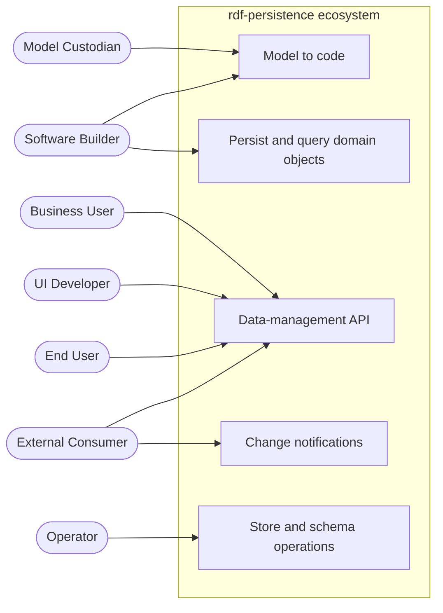
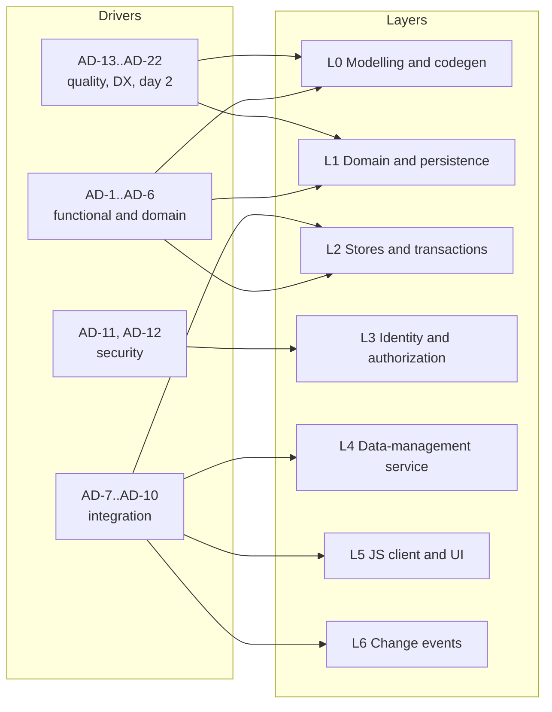

# Business context and architectural drivers

Change: `soa-python-rdf-orm` · task 6.1 · status: analysis for the developer (no decisions taken here) · refreshed with round-4 findings (DDD, DX, evolution, property graphs).

**Sources** (short tags used in every citation):

| Tag | File |
|---|---|
| `brief Ln` | `inputs/brief-2026-11-03.md`, line n |
| `mwb2 Ln` | `inputs/brief-2026-11-03-mwb2-scope.md`, line n (includes the Confluence digests: LinkML evaluation L18, Fluree evaluation L23, Model2OWL–LinkML L29, MWBv2 runbook L31, How do we code L37, follow-up L41–44) |
| `RAD Ln` | `inputs/confluence-sota-rad-2026-11-03.md`, line n |
| `DEC-n` | `proposal.md`, key decisions |
| `SoA:<page>` | `docs/modules/ROOT/pages/architecture/soa/<page>.adoc` (index, building-blocks, variants, catalogue, angles/*) |

## 1. Problem and goal

Teams at Meaningfy build data-centric Linked Data applications (the Mapping Workbench v2 style):
a conceptual model drives generated code, a Python backend persists domain objects in a triple
store, and a JavaScript UI works with the data as JSON-LD. Today every project hand-writes the
persistence layer, the API and the authorization glue, because no Python object–RDF mapper is
mature enough to build on (SoA:index "Bottom line" 1; every mapper fails DEC-5).

**Goal.** A developer-friendly persistence library — an ORM or a repository/unit-of-work layer —
over any SPARQL 1.1 triple store, plus the companions that make the whole model → backend →
service → JS UI chain fast to build and easy to maintain (brief L6–L11; mwb2 L5; DEC-7, DEC-10,
DEC-11). The library stays thin: it reuses rdflib, pyoxigraph, LinkML and the SPARQL clients
(DEC-4) and never implements authorization (DEC-8).

**Scope of this analysis.** The *system of interest* is the **rdf-persistence ecosystem**: the
rdf-persistence library and the companions it implies (code-generation templates, a generated
data-management service, a generated JS client contract). Stores, identity providers,
authorization engines and UI frameworks are external.

## 2. Actors

| Actor | Kind | Goal with the system |
|---|---|---|
| **Business User** | person | Gets an application whose data model matches the domain, delivered quickly (RAD L4; DEC-3). |
| **Model Custodian** (data modeller) | person | Owns the conceptual model (UML → OWL/SHACL → LinkML) and its evolution; wants code that follows the model without hand edits (mwb2 L31; DEC-7). |
| **Software Builder** (backend developer) | person | Writes domain logic; wants CRUD, transactions and queries over RDF without writing SPARQL by hand (brief L6–L10; DEC-12). |
| **UI Developer** | person | Builds the JS/TS UI with mainstream tooling against a stable contract, without RDF expertise (mwb2 L5; RAD L4). |
| **Operator** | person | Runs, configures and migrates the deployment: store, identity, policies, events (mwb2 L14; tasks 4.10). |
| **End User** | person | Uses the application; sees and changes only the data they are permitted to (DEC-8). |
| **External Consumer** | person or system | Reads the data as JSON-LD or through SPARQL, or subscribes to changes (DEC-10 L4/L6; SoA:variants V5). |

External systems (L1): **Triple Store** (any SPARQL 1.1 store; Fluree as option), **Identity
Provider**, **Authorization Engine** (decision point), **Event Channel**, **Modelling Toolchain**
(UML/Enterprise Architect, model2owl), **Property-Graph Store** (side question, DEC-14).

PlantUML: [`diagrams/bc-actors-goals.puml`](diagrams/bc-actors-goals.puml)

## 3. Core functions

1. Generate a typed, persistence-free domain from the model, plus (optionally) repositories,
   service routes and a client contract (brief L9; mwb2 L31; DEC-7).
2. Map domain objects to RDF and back, with identity by IRI (brief L8; DEC-4).
3. Create, read, update and delete aggregates in one transaction (brief L8, L11).
4. Query and navigate the object graph with a typed, safe query API (brief L10; DEC-2, DEC-12).
5. Run behind any authorization arrangement without holding policy (brief L11; mwb2 L5, L14; DEC-8).
6. Serve the domain as a data-management API that JS tooling consumes (mwb2 L5; DEC-3, DEC-7).
7. Publish change events (DEC-10 L6; mwb2 L41–42 "message").
8. Swap or add stores, including Fluree; assess property graphs (mwb2 L23; DEC-10, DEC-14).
9. Evolve the schema and migrate data; test against real stores (mwb2 L31, L37; tasks 4.10).

## 4. Architectural drivers

A driver is a requirement that shapes structure. Each one names its source and the decision area
it feeds (ADR ids refer to [`candidate-adrs.md`](candidate-adrs.md)).

### Functional and domain drivers

| Id | Driver | Source | Shapes |
|---|---|---|---|
| **AD-1** | Two entry modes: declare classes in code (SQLAlchemy-like) **or** generate domain + repository layer from LinkML (cosmic-python style). | brief L8–L9 | ADR-03, ADR-08 |
| **AD-2** | Full CRUD with transaction management handled by the library. | brief L8, L11 | ADR-07, ADR-09, ADR-10 |
| **AD-3** | rdflib as the default stack; portable over SPARQL 1.1 query and update. | brief L10; DEC-2 | ADR-05, ADR-10 |
| **AD-4** | DDD consistency boundaries: what changes together in one transaction (aggregate) vs what is decoupled by messages; is a unit of work needed? | mwb2 L41–44; DEC-13 | ADR-07, ADR-09, ADR-06 |
| **AD-5** | Model-driven chain: UML → model2owl → LinkML → generated, never-edited code, regenerated at build and test time. | mwb2 L31; DEC-7 | ADR-03, ADR-08 |
| **AD-6** | A persistence backend speaking JSON-LD; a middleware layer over the store that the UI uses. | brief L11; mwb2 L5, L31 | ADR-01, ADR-04 |

### Integration drivers

| Id | Driver | Source | Shapes |
|---|---|---|---|
| **AD-7** | Friendly to the JS ecosystem: modern JS libraries consume JSON-LD from the service; RAD experience like mu.semte.ch / semantic.works. | mwb2 L5; RAD L4–5; DEC-3 | ADR-04 |
| **AD-8** | Several architecture variants (V1–V5) and development approaches (A–D; D = hand-written classes, code-first) composable from the same core. | DEC-10 | ADR-01, ADR-05 |
| **AD-9** | Store switching, including Fluree (open action: Fluree vs Fuseki/GraphDB repository); property graphs as a side question. | mwb2 L23, L41; DEC-10, DEC-14 | ADR-05 |
| **AD-10** | Change events (L6) for UI refresh and for decoupled aggregates. | DEC-10 (L6); mwb2 L41 | ADR-06 |

### Security drivers

| Id | Driver | Source | Shapes |
|---|---|---|---|
| **AD-11** | ACL-agnostic persistence: works behind an authorizing proxy or with a pluggable enforcement point. | mwb2 L5; DEC-8 | ADR-02 |
| **AD-12** | Authorization borrowed, never reinvented; graph-level, triple-level preferred; declarative, SPARQL-like, data-centric policy language preferred (Fluree, semantic.works); IdP such as Zitadel. | brief L11; mwb2 L5, L14; DEC-8 | ADR-02, ADR-05 |

### Quality and organisational drivers

| Id | Driver | Source | Shapes |
|---|---|---|---|
| **AD-13** | Developer experience developers love: CRUD plus a query in about 10 lines (ODMantic 9, Django 11), few concepts, typed API, errors that name model, IRI and fix with a stable code. | brief L6; DEC-12; SoA:angles/dx | ADR-07, ADR-08, ADR-15 |
| **AD-18** | Learnability through mainstream conventions: Pydantic models, `select(Model).where(...)`, `with session.begin()`, FastAPI `Depends`, no globals, async parity, in-memory store for tests. | DEC-12; SoA:angles/dx "Conventions" | ADR-07, ADR-15 |
| **AD-19** | Transparent persistence: the commit is a value that can be printed and tested (`preview()`), every query can be shown (`to_sparql()`); no hidden autoflush or lazy loads. | DEC-12, DEC-13; SoA:design-implications | ADR-07, ADR-12 |
| **AD-20** | Bounded contexts: one LinkML schema module per context; only IRIs and events cross contexts; aggregate boundaries declared in the model. | mwb2 L41–44; DEC-13; SoA:angles/ddd | ADR-11, ADR-14 |
| **AD-21** | Keep property graphs possible without breaking the API: abstract change set, query syntax tree with renderers, raw SPARQL on its own port, named graph as a scope. | mwb2 L41; DEC-14; SoA:angles/lpg | ADR-05, ADR-07 |
| **AD-22** | Observability and operations: store-port spans (no SPARQL conventions exist in OpenTelemetry), backup and restore per store, upgrade paths. | tasks 4.10; SoA:angles/evolution "Operations" | build list |
| **AD-14** | Reuse mature foundations; own only the ORM / repository / unit-of-work layer; dependency only if > 200 stars and a commit in 12 months. | DEC-4, DEC-5 | all |
| **AD-15** | Coherent ecosystem, composable and maintainable. | DEC-11 | ADR-01, ADR-04 |
| **AD-16** | Testability: TDD, Gherkin, Cypress E2E, coverage ≥ 90 %. | mwb2 L31, L37 | ADR-05 (store port), build list |
| **AD-17** | Day-2 evolution: a LinkML schema change becomes reviewed, ordered, recorded SPARQL Update migrations, gated by the new version's SHACL shapes; regeneration on every model or LinkML upgrade. | tasks 4.10; mwb2 L31 (regeneration); SoA:angles/evolution | ADR-03, ADR-08, ADR-16 |

### Constraints (facts found by the review that bound every option)

| Id | Constraint | Evidence |
|---|---|---|
| **K-1** | One SPARQL Update request is the only portable atomic unit; multi-request transactions exist only through vendor APIs. | SoA:angles/stores headline 2–3 |
| **K-2** | Oxigraph does not detect write conflicts; no Python mapper protects against lost updates. | SoA:angles/stores headline 4; SoA:index anti-patterns |
| **K-3** | Graph level is the only portable authorization granularity; no authorization engine speaks SPARQL. | SoA:angles/authz key findings |
| **K-4** | No Python object–RDF mapper passes DEC-5: the core must be built. | SoA:index bottom line 1 |
| **K-5** | Licences: Fluree v4 is BUSL-1.1; Zitadel server is AGPL-3.0; rdfproxy is GPL-3.0. | SoA:index open questions 1; SoA:catalogue |
| **K-6** | LinkML gaps: IRIs typed as `str`, language-tagged strings lost, weak TypeScript output, no route/repository generator. | mwb2 L18; SoA:angles/codegen |
| **K-7** | A failed guard skips only its own update operation, not the request: all-or-nothing needs **one** `DELETE … INSERT … WHERE` whose WHERE joins every guard; Update returns no match count, so success is confirmed by an ASK on an append-only commit record unique to this commit, written inside the same operation — not on a "last transaction" marker, which a writer committing right after us would overwrite (false conflict). Outbox triples and new owned children must sit inside the same operation (a separate `INSERT DATA` still runs when the guard fails); new aggregates need a `FILTER NOT EXISTS` creation guard. Implemented nowhere yet; untested on real stores. | SoA:angles/ddd, angles/stores (round 5); design-implications |
| **K-11** | Not every store serialises guarded updates against concurrent writers: Fuseki/TDB2, in-memory Oxigraph and Fluree HTTP do; on-disk Oxigraph checks the guard on a snapshot and writes the batch without a lock (needs an adapter write lock); RDF4J/GraphDB untested. The confirming ASK must go to the primary, never a replica. | SoA:angles/stores (round 5); design-implications "Store capability" |
| **K-8** | Blank nodes are not allowed in DELETE templates: owned children need IRIs (derived from the root, or skolemised). | SoA:angles/ddd |
| **K-9** | LinkML has no composition construct (`inlined` is a serialisation hint, `tree_root` a document container): aggregate boundaries need annotations or a convention. | SoA:angles/ddd "Declaring boundaries in LinkML" |
| **K-10** | No Python RDF migration runner, no LinkML schema diff, no LinkML → SPARQL migration compiler exist; mu-migrations-service has no checksum, lock or down migrations. | SoA:angles/evolution |

PlantUML: [`diagrams/bc-drivers-layers.puml`](diagrams/bc-drivers-layers.puml)

## 5. Unknowns that would normally be drivers

No ask states numbers for these. They are open questions for the developer, not assumptions:

1. **Scale:** data volume per store, concurrent writers, read/write ratio (decides V5 / CQRS).
2. **Latency:** budget for a list read under authorization (decides PDP call pattern and caching).
3. **Availability:** uptime target, single-writer acceptable? (decides embedded Fluree and Oxigraph E variant).
4. **Granularity:** is graph-level authorization enough, or is triple-level required? (decides V3/V4).
5. **Licences:** BUSL-1.1 (Fluree) and AGPL-3.0 (Zitadel) acceptable for MWBv2 products?
6. **Free SPARQL from the UI:** will the UI ever send ad-hoc queries? (only store-native or proxy enforcement is safe then).
