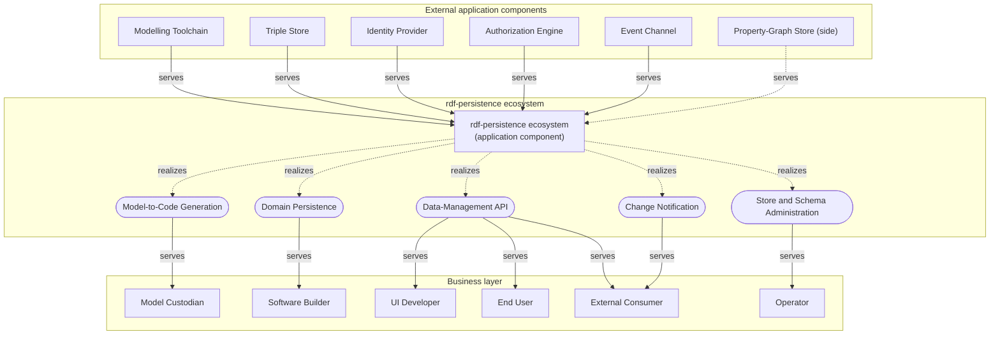
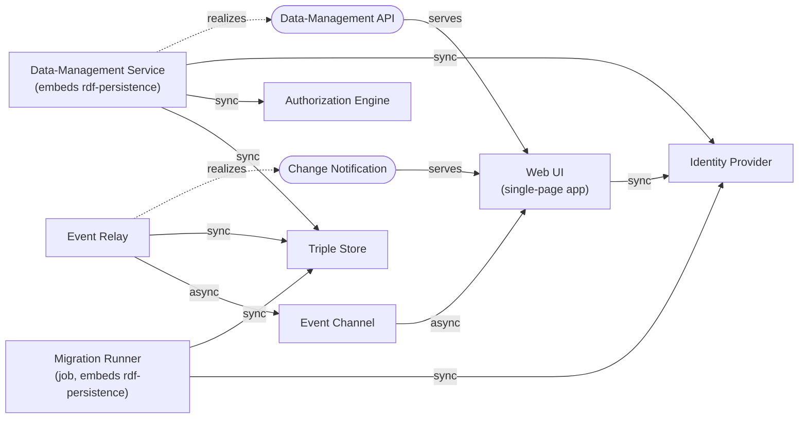
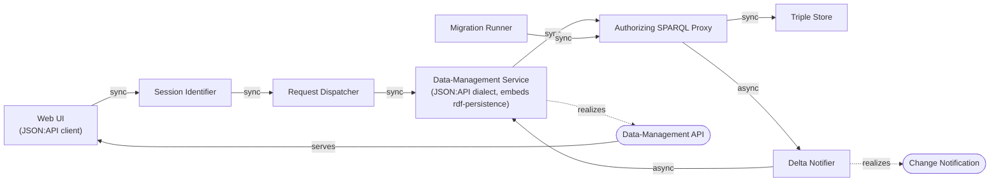
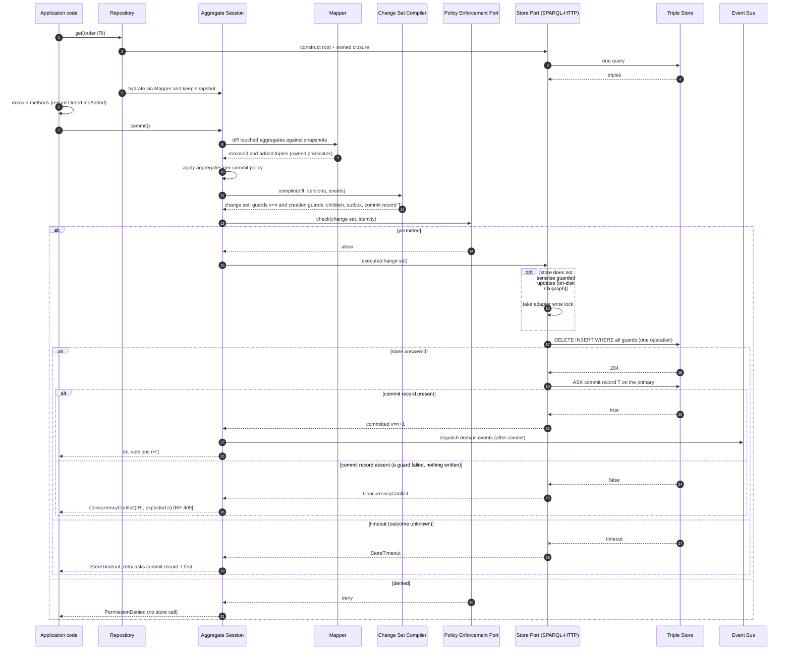
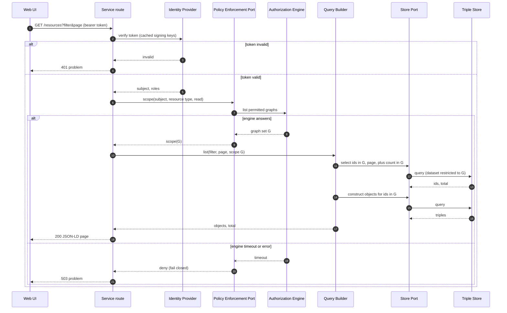
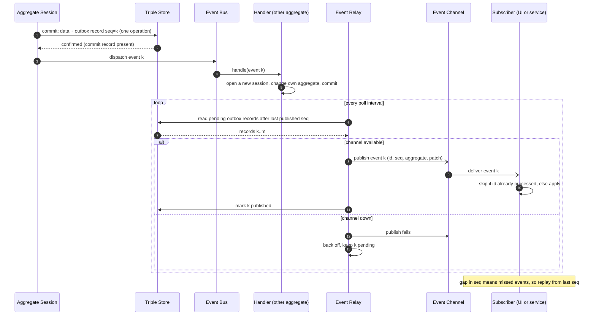
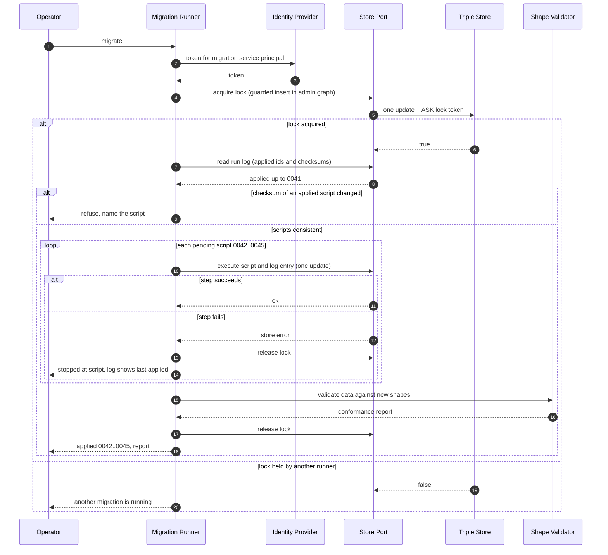

# C4 views

Change: `soa-python-rdf-orm` · task 6.4. Notation: ArchiMate semantics at C4 Context and Container (Business Actor,
Application Component, Application Service; Serving, Realization, Flow), UML at C4 Component (components,
interfaces, dependencies labelled with interaction style) and for sequences. Technology names
appear only as *candidate* notes, never as element names. Every diagram also exists as a
PlantUML file under [`diagrams/`](diagrams/).

## 1. System context (C4 Context)

The system of interest is the **rdf-persistence ecosystem** (library + generated service +
client contract). It offers five application services. External systems are reached only
through those services or the ports behind them.



PlantUML: [`diagrams/l1-context.puml`](diagrams/l1-context.puml)

| Service | Use cases |
|---|---|
| Model-to-Code Generation | UC-W1, UC-W8 |
| Domain Persistence | UC-W2, UC-W3, UC-W10 |
| Data-Management API | UC-W4, UC-W5, UC-W6 |
| Change Notification | UC-W7 |
| Store and Schema Administration | UC-W8, UC-W9 |

## 2. Containers (C4 Container)

rdf-persistence is a **library**, not a container: it runs in-process inside the
Data-Management Service (and inside the Event Relay for outbox reads). The code generator is a
build-time tool and is therefore not a runtime container; it appears in the component view as a separate
package.

### 2.1 V1 Portable Python core



PlantUML: [`diagrams/l2-containers-v1.puml`](diagrams/l2-containers-v1.puml)

Candidate technology (not part of the model): service = FastAPI; store = Oxigraph (dev),
Fuseki or GraphDB (prod); IdP = Zitadel or Keycloak; engine = OpenFGA, SpiceDB or pycasbin
(in-process, then no separate container); channel = SSE gateway or broker.

### 2.2 V2 semantic.works-compatible



PlantUML: [`diagrams/l2-containers-v2.puml`](diagrams/l2-containers-v2.puml)

Candidate technology: identifier, dispatcher, `sparql-parser`, delta-notifier, mu-migrations,
Virtuoso (semantic.works blueprint, SoA:libraries/semantic-works).

### 2.3 V3–V5: differences from V1

| Variant | Containers added / removed | Flow changes | Consequence |
|---|---|---|---|
| V3 Fluree | Triple Store = Fluree ledger; Authorization Engine removed (policies in the store); Event Relay optional (store emits head events) | Service forwards the user's identity to the store | Port in pass-through mode; triple-level policy; BUSL licence |
| V4 GraphDB | Triple Store = GraphDB; Authorization Engine optional (store FGAC) | Service ↔ store uses multi-request transactions | Transactional adapter; roles from IdP claim mapped in the store |
| V5 Graph-direct reads | + Policy-aware Read Endpoint, + Read Replica | UI → Read Endpoint (sync, reads); Event Relay → Read Replica (async) | Read path bypasses domain rules; needs proxy or store-native graph ACL |

## 3. Components of rdf-persistence, inside the Data-Management Service (C4 Component)

Shaped by round 4 (`design-implications.adoc`, angles ddd, dx, lpg): a thin **aggregate session**
instead of a full SQLAlchemy-style unit of work; an **abstract change set** compiled into one
guarded operation; a **query tree** with renderers; a **store port with a capability
descriptor**; a **policy-enforcement port** with three modes; an **outbox** with an in-process
bus. Codegen (incl. the field-metamodel generator) is a separate build-time package. The runtime
count (ten) exceeds the 6–8 guideline because the brief names each part; grouping keeps it
readable.

```mermaid
flowchart TB
  APP["Service routes / domain code"]
  subgraph RP["rdf-persistence (in-process library)"]
    subgraph Session["Session"]
      REPO["Repository (per aggregate root)"]
      AS["Aggregate Session<br/>identity map, snapshots, commit policy"]
    end
    MAP["Mapper<br/>owned predicates"]
    CSC["Change Set Compiler<br/>single guarded operation"]
    QB["Query Builder<br/>query tree"]
    subgraph Ports["Ports"]
      SP["Store Port"]
      CAP["Capability Descriptor"]
      PEP["Policy Enforcement Port<br/>pass-through / scope / change check"]
      RAW["Raw SPARQL Port"]
      OB["Outbox + Event Bus"]
    end
    subgraph Adapters["Store adapters"]
      AH["SPARQL-HTTP Adapter"]
      AT["Transactional Adapter"]
      AE["Embedded Adapter"]
    end
  end
  subgraph BT["rdf-persistence-codegen (build time)"]
    MMG["Metamodel Generator<br/>Person_, TypedDicts, errors"]
    BC["Boundary Checker"]
    TPL["Templates<br/>repositories, routes, contract"]
  end
  STORE["Triple Store (container)"]
  ENG["Authorization Engine (container)"]
  APP -->|in-process| REPO
  APP -->|in-process| AS
  REPO -->|in-process| AS
  REPO -->|in-process| QB
  AS -->|in-process| MAP
  AS -->|in-process| CSC
  AS -->|in-process| PEP
  AS -->|in-process| OB
  CSC -->|in-process| SP
  QB -->|in-process| PEP
  QB -->|in-process| SP
  SP -->|in-process| CAP
  AH -. implements .-> SP
  AT -. implements .-> SP
  AE -. implements .-> SP
  AH -. implements .-> RAW
  AH -->|SPARQL protocol (sync)| STORE
  AT -->|vendor transaction API (sync)| STORE
  PEP -->|decision request (sync)| ENG
  MMG -. generates .-> APP
  TPL -. generates .-> APP
  BC -. checks .-> TPL
```

PlantUML: [`diagrams/l3-rdf-persistence.puml`](diagrams/l3-rdf-persistence.puml)

| Component | Responsibility | Interface it offers | Use cases | Build |
|---|---|---|---|---|
| Repository | One per aggregate root: get (root + owned closure in one query), add, remove, find | `Repository[T]` | W2, W3 | BL-4 |
| Aggregate Session | Identity map, snapshots, tracks aggregates loaded through its repositories, applies the aggregates-per-commit policy, `preview()`, `commit()`, after-commit hooks | `Session` (context manager, FastAPI dependency) | W2 | BL-2 |
| Mapper | Object ↔ triples from IRI metadata; owned predicates only; multi-valued, `LangString`, not-loaded sentinel; holds the version as metadata | `Mapper` | W1–W3 | BL-1 |
| Change Set Compiler | Diff → abstract change set (removed/added triples, version and creation guards, append-only commit record, outbox records — all in one operation) → rendered by the adapter as one guarded operation | `ChangeSet` (a printable value) | W2, W7 | BL-3 |
| Query Builder | Query syntax tree, bound values, explicit loading, projections, `to_sparql()`; SPARQL is one renderer | `Query[T]` | W3 | BL-4 |
| Store Port | Executes change sets and queries; confirms the commit record on the primary (or uses the commit receipt / transaction outcome); OTel spans | `StorePort` | W2, W9 | BL-5 |
| Capability Descriptor | Declares `single_request_atomic`, `multi_request_tx`, `degraded`, `serialises_guarded_updates` (false for on-disk Oxigraph → adapter write lock), confirmation mode, named graphs, query language; drives the commit path | `Capabilities` | W2, W9 | BL-5 |
| Policy Enforcement Port | Mode `pass-through` (forward identity), `scope` (graph restriction on every query incl. counts), `change-check` (before commit) | `PolicyEnforcementPort` | W4 | BL-6 |
| Raw SPARQL Port | Escape hatch returning models; RDF-only, never on `Repository[T]` | `SparqlPort` | W3 | BL-4 |
| Outbox + Event Bus | Adds event records to the change set; dispatches in process after confirmation | `Outbox`, `EventBus` | W7 | BL-7 |
| Adapters | SPARQL-HTTP, transactional, embedded implementations | `StorePort` | W9 | BL-5 |
| Metamodel Generator, Boundary Checker, Templates | Build time: typed field metamodel, filter types, errors; aggregate-boundary derivation and build failures; repositories, routes, contract | CLI / `make generate-models` | W1, W8 | BL-10 |

Interface ownership: the library owns `StorePort`, `Capabilities`, `PolicyEnforcementPort` and
the outbox record format; adapters, policy bindings and the Event Relay implement or consume
them. Property-graph support would be one more adapter rendering the same change set and query
tree (AD-21).

## 4. Use-case to container trace

| Use case | V1 containers | Key components (C4 Component) |
|---|---|---|
| UC-W2 | Data-Management Service → Triple Store | Aggregate Session, Mapper, Change Set Compiler, Store Port, Outbox |
| UC-W3 | Data-Management Service → Triple Store | Repository, Query Builder, PEP |
| UC-W4 | Data-Management Service → Identity Provider, Authorization Engine | PEP |
| UC-W7 | Event Relay → Event Channel → Web UI | Outbox + Event Bus |
| UC-W8 | Migration Runner → Triple Store (as a service principal) | Store Port, Policy Enforcement Port |

## 5. Sequences

### 5.1 Commit an aggregate

Realises UC-B2.1 (+UC-B4.3, UC-B7.1). Happy path, version conflict, unknown outcome after a
timeout, and permission denial. **One** update operation carries every version guard, the data,
the new owned children, the outbox records and an append-only commit record unique to this commit (K-7); new aggregates carry a `FILTER NOT EXISTS` creation guard. The confirming ASK goes to the primary and looks for *this* commit record, not a "last transaction" marker (which a later writer would overwrite).



PlantUML: [`diagrams/seq-commit-aggregate.puml`](diagrams/seq-commit-aggregate.puml)

Capability-driven variants of step "execute": with `multi_request_tx` the same change set runs
inside a store transaction and needs no ASK (UC-B2.2; also Fluree's commit receipt); with `degraded` the session refuses unless degradation was
enabled (UC-B2.3).

### 5.2 Authorized list read

Realises UC-B3.2 + UC-B4.2 (V1). The scope is applied before paging and to the count.



PlantUML: [`diagrams/seq-authorized-read.puml`](diagrams/seq-authorized-read.puml)

### 5.3 Change-event propagation

Realises UC-B7.1. In-process dispatch happens after commit confirmation; external delivery is
asynchronous and at least once, driven by the outbox records written in the commit.



PlantUML: [`diagrams/seq-change-event.puml`](diagrams/seq-change-event.puml)

### 5.4 Run schema migrations

Realises UC-B8.1 (V1). The runner is a job over the same store port, authenticated as a permitted
service principal; lock, checksum and log are triples in an admin graph.



PlantUML: [`diagrams/seq-migrate.puml`](diagrams/seq-migrate.puml)
