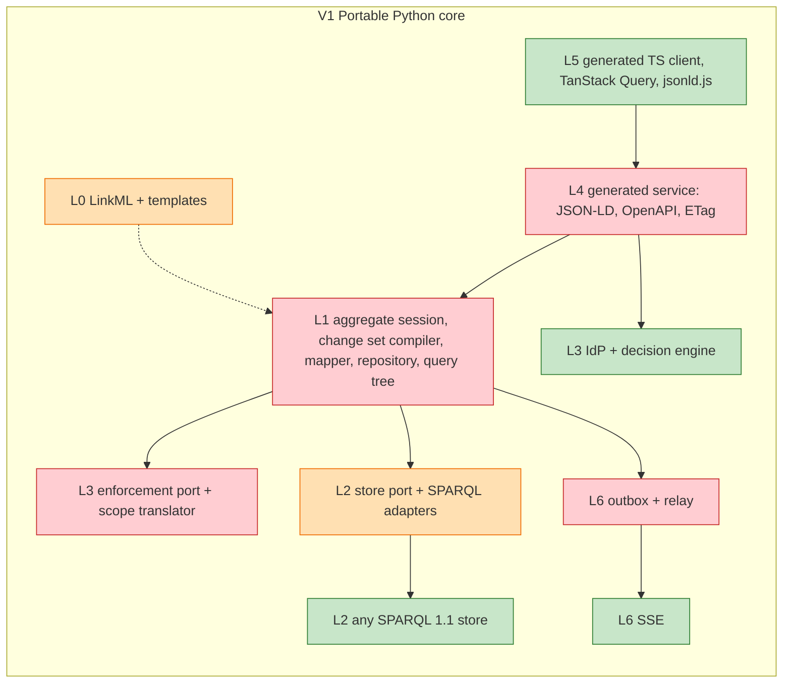
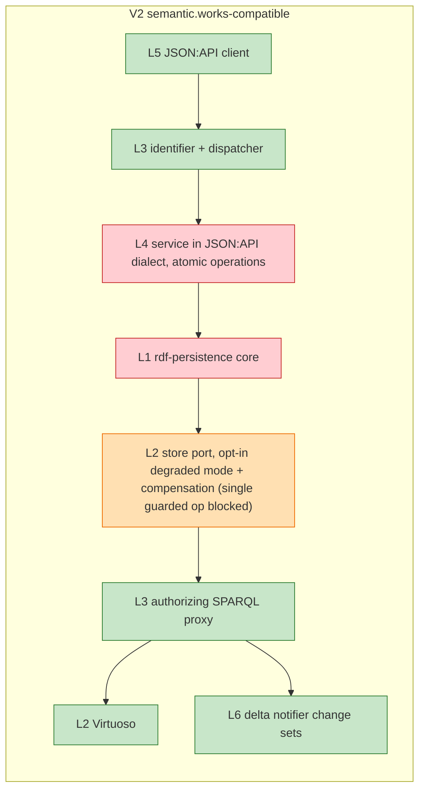
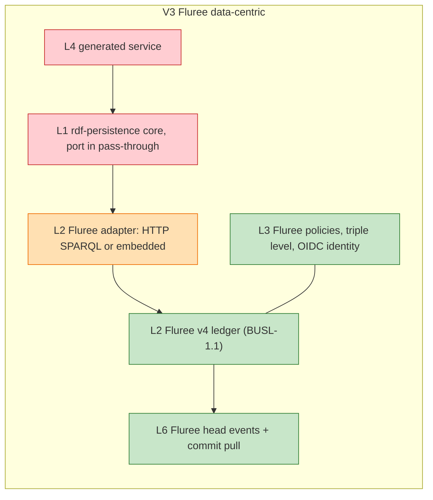
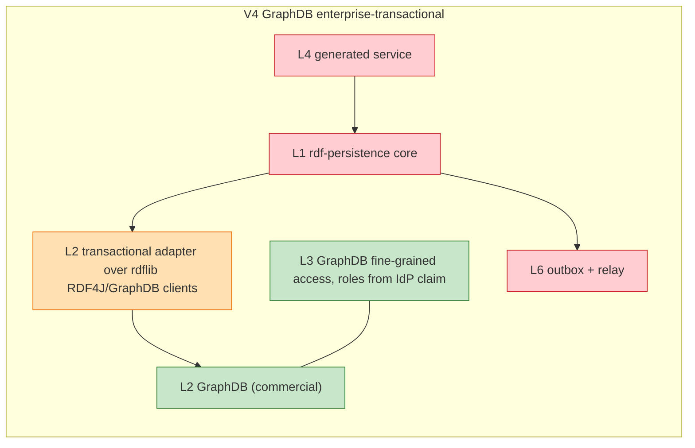
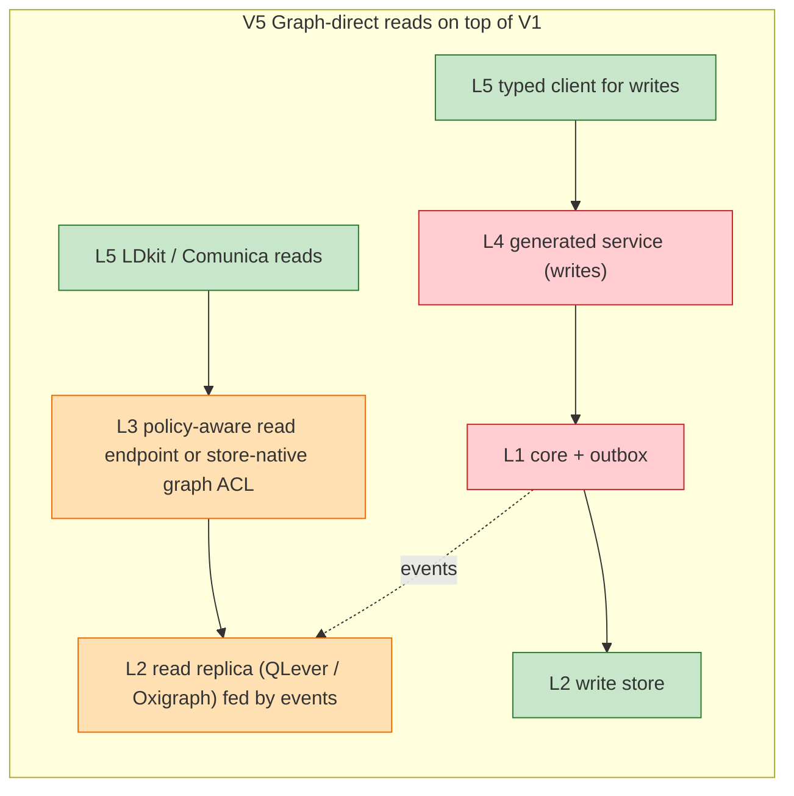

# Realisation matrix — use case × layer × variant × build-vs-reuse

Change: `soa-python-rdf-orm` · task 6.3 · inputs: [`use-cases.md`](use-cases.md),
`docs/.../soa/variants.adoc` (V1–V5, approaches A–C; approach D, hand-written classes, added here), `building-blocks.adoc` (L0–L6),
`catalogue.adoc`, `angles/*.adoc` (round 4: ddd, dx, evolution, lpg), `design-implications.adoc`.

**Status legend**

| Mark | Meaning |
|---|---|
| **E-dep** | exists — reuse as a **dependency** (passes DEC-5) |
| **E-int** | exists — **integrate**: run next to our parts through a standard contract |
| **E-comp** | exists — **compatible**: honour its contract or format, not its code |
| **E-bt** | exists — build-time tool |
| **P** | **partial** — exists, but a stated gap must be closed (glue, template, fix) |
| **M** | **missing** — must be built (ideas source named where one exists) |

Evidence tags: `cat` = catalogue.adoc, `bb` = building-blocks.adoc, `idx` = index.adoc,
`st` / `az` / `sv` / `js` / `cg` / `ddd` / `dx` / `evolution` / `lpg` = the angle pages; `design-implications` = design-implications.adoc.

**Variants** (variants.adoc): V1 portable Python core · V2 semantic.works-compatible · V3 Fluree
data-centric · V4 GraphDB enterprise-transactional · V5 graph-direct reads (CQRS, added to V1).
**Approaches**: A runtime mapper · B generated mapper and routes · C generic service.

---

## UC-W1 Model the domain and generate code

**Fulfilled by:** the model passes the quality gate, aggregate boundaries are derived and
checked, LinkML generates the persistence-free Pydantic classes (with `class_uri`/`slot_uri`),
shapes and context; approach B adds our templates for repositories, the typed field metamodel,
routes and the client contract. **Layers:** L0 (→ L1, L4, L5). **Variants:** all.
**Approaches:** A = B1.1, B = B1.2 (best DX fit, SoA:angles/dx), C = B1.4, D = B1.3 (hand-written classes, code-first: same mapper metadata from `Annotated` markers / class attributes instead of generated `linkml_meta`; fastest start; no schema single source of truth; no generated SHACL, TS or OpenAPI unless reverse-generated from the classes; ADR-03 stays open).

| Layer | Component | Status | Evidence |
|---|---|---|---|
| L0 | UML / Enterprise Architect + model2owl (UML → OWL/SHACL) | E-bt (in-house; DEC-5 exception needed) | cat model2owl |
| L0 | schema-automator (SHACL → LinkML); linkml-map (object-level reshapes) | E-bt | cat; cg |
| L0 | LinkML generators: Pydantic, SHACL, OWL, JSON Schema, JSON-LD context | E-dep | cat LinkML; bb L0 |
| L0 | Full mapping metadata in generated classes (`metadata_mode=full`) + completeness check | **P** (option exists; check missing) | design-implications "Mapping metadata" |
| L0 | IRI types (`AnyUrl`), language-tagged strings, TS enums/dates | **P** (template fix or upstream PR) | cg key findings; mwb2 L18 |
| L0 | Aggregate-boundary derivation and build checks (annotations or `inlined`+`shared` convention) | **M** (LinkML has no composition construct) | ddd "Declaring boundaries in LinkML" |
| L0 | Templates: repositories, field metamodel `Person_`, filter TypedDicts, per-class exceptions, routes, full OpenAPI, JSON:API config, frames | **M** | cg; dx "Proposed features"; sv key findings |
| L0 | Owlready2 reasoner check of generated OWL | E-bt (optional) | cat Owlready2 |
| L1 | Mapper reading IRI metadata at runtime | **M** (ideas: pydantic-rdf, OldMan) | bb L1; idx patterns "Mapping" |
| L1 | Code-first declarations (`Annotated` IRI markers) | **M** (ideas: pydantic-rdf, SeMPyRO) | cat pydantic-rdf |
| L1 | pydantic, pySHACL | E-dep | cat foundations |
| L4 | Generic schema-driven service (approach C) | **M** for RDF (ideas: mu-cl-resources, linkml-store) | cat linkml-store; variants approach C |

## UC-W2 Persist an aggregate in one transaction

**Fulfilled by:** the **aggregate session** (Spring Data JDBC boundaries + SQLAlchemy identity map
and change detection + Ecto change set as a value) diffs the loaded aggregates against their
snapshots; the change set compiler emits **one** `DELETE … INSERT … WHERE` joining every version
guard (plus creation guards for new aggregates), with outbox records, new owned children and an append-only commit record all inside that operation; an ASK on the commit record, sent to the primary, confirms; the store port's
capability descriptor switches to a vendor transaction or to opt-in degradation.
**Layers:** L1, L2 (+L3 change check, L6 outbox). **Variants:** V1/V5 → B2.1; V3 → B2.1 over HTTP
or B2.2 embedded; V4 → B2.1 or B2.2; V2 → **blocked** for the single guarded operation, B2.3 only
(SoA:angles/ddd variant fit). **Approaches:** all; B best fit (generated repositories).

| Layer | Component | Status | Evidence |
|---|---|---|---|
| L1 | Aggregate session: identity map, snapshots, tracking via repositories, commit policy (strict/warn/allow), `preview()`, after-commit hooks | **M** (ideas: SQLAlchemy session, Spring Data JDBC, Ecto, cosmic-python `seen`) | ddd "Do we need a Unit of Work?"; design-implications |
| L1 | Owned-predicate diff; delete set from the snapshot; foreign triples kept | **M** (ideas: triplemodel, OldMan) | ddd A1; idx patterns "Writes" |
| L1 | Root + owned closure load (one CONSTRUCT along owned predicates); child IRIs derived from the root | **M** | ddd "Aggregates in a graph" A1 |
| L1 | Change set compiler → single guarded operation (version + creation guards; outbox and new children inside) + append-only commit record + ASK on the primary | **M** (implemented nowhere; untested on stores) | ddd "The single guarded operation" |
| L1 | Version held as mapper metadata; `version_of(obj)` for ETags | **M** | ddd step 7 |
| L1 | Validation before commit (pySHACL on the aggregate's graph) | E-dep | cat pySHACL; dx principles |
| L2 | One joined update per commit: rdflib `SPARQLUpdateStore` | **P** (exists; no single-operation guard, no commit record, no capability report) | st headline 2; cat rdflib |
| L2 | Multi-request transactions: rdflib `contrib.rdf4j` / `contrib.graphdb`; embedded Fluree `transact(fn)` | E-dep / E-int | st P-c, P-d |
| L2 | pyoxigraph / oxrdflib (embedded; no conflict detection) | E-dep | st headline 4 |
| L2 | Fluree v4 (HTTP SPARQL; embedded `fluree` package) | E-int (BUSL-1.1) | st Fluree; cat |
| L2 | Store port with capability descriptor (T7; also named graphs, query language, *serialises guarded updates*, confirmation mode: ASK / commit receipt / transaction) | **M** (none found) | st patterns; st round 5; lpg "Four seams" |
| L2 | Opt-in degradation with compensation log (P-e) | **P** (rdflib `AuditableStore` exists; wiring missing) | st P-e; ddd step 6 |
| L6 | Outbox records in the same operation (P-i) | **M** (none found) | st P-i; ddd |

## UC-W3 Query and navigate domain objects

**Fulfilled by:** repository loads whole aggregates; references are `Ref[T]` IRIs loaded
explicitly in one batched query; cross-aggregate reads use typed projections or read models;
the query builder is a syntax tree with a SPARQL renderer and a printable `to_sparql()`; raw
SPARQL sits on its own port. **Layers:** L1, L2 (+L3). **Variants:** all; V5 adds read model /
graph-direct (B3.3, B6.2). **Approaches:** all; B gives the typed field metamodel.

| Layer | Component | Status | Evidence |
|---|---|---|---|
| L1 | Query syntax tree + SPARQL renderer; bound values; `to_sparql()` and query logging | **M** (ideas: Prez typed AST, neomodel `QueryAST`, Drizzle `.toSQL()`) | idx patterns "Queries"; dx principles; lpg seams |
| L1 | Typed field expressions `select(Person).where(Person_.name == …)` (generated metamodel) | **M** (precedent: JPA static metamodel) | dx "Typed expression queries" |
| L1 | Explicit loading: `Ref[T]`, batched `load()`, not-loaded sentinel | **M** (ideas: Ecto `NotLoaded`, SQLAlchemy `lazy="raise"`) | dx principles; ddd step 1 |
| L1 | Typed read-only projections; read models (B3.3) | **M** (ideas: rdfproxy, Beanie `projection_model`) | cat rdfproxy; dx principles |
| L1 | Raw SPARQL port returning models (`s.sparql(q, as_=T)`) | **M** | design-implications "Seams" |
| L2 | SPARQL clients: rdflib stores, SPARQLWrapper | E-dep | cat foundations |
| L2 | Read replica for V5: QLever or Oxigraph | E-int | st variant F |

## UC-W4 Restrict data to what the user is permitted

**Fulfilled by:** IdP authenticates; either the store/proxy enforces (B4.1) or an external engine
decides and our port applies the decision as a graph restriction (B4.2) and a change-set check
(B4.3). **Layers:** L3 (+L1 port, L4 token handling). **Variants:** V1 → B4.2 + B4.3; V2 → B4.1
(sparql-parser); V3 → B4.1 (Fluree policies, triple level); V4 → B4.1 (GraphDB FGAC) or B4.2;
V5 → B4.1 on the read endpoint + B4.2 on the API. **Approaches:** all.

| Layer | Component | Status | Evidence |
|---|---|---|---|
| L3 | Identity provider: Zitadel (AGPL server), Keycloak fallback | E-int | cat Zitadel, Keycloak |
| L3 | Token validation: Authlib / PyJWT | E-dep | cat |
| L3 | Decision engine: OpenFGA or SpiceDB (list objects); pycasbin minimal; Cerbos (plan AST) | E-int | az key findings; cat |
| L3 | Store-native policies: Fluree (triple), GraphDB FGAC (triple), jena-fuseki-access (graph, read-only) | E-int | az; cat |
| L3 | Authorizing SPARQL proxy: semantic.works `sparql-parser` | E-int (fails DEC-5: DEC-5 exception needed; open whether DEC-5 applies to services) | cat sparql-parser |
| L1 | Policy Enforcement Port (pass-through, scope, change check) | **M** (port only, no engine) | az "For rdf-persistence: one port"; bb L3 |
| L1/L4 | Scope translator: engine decision (list, plan AST) → graph restriction | **M** (exists nowhere) | az key findings 4 |
| L2 | Identity forwarded in the store request context | **M** (part of store port) | st "port carries an opaque request context" |

## UC-W5 Serve the domain as a data-management API

**Fulfilled by:** generated or generic routes on the service framework; repositories and unit of
work underneath; content negotiation; conditional writes. **Layers:** L4 (+L1, L3). **Variants:**
V1, V3, V4, V5 → B5.1; V2 → B5.2. **Approaches:** B generates routes; A uses a generic router; C
interprets the schema.

| Layer | Component | Status | Evidence |
|---|---|---|---|
| L4 | FastAPI; PyLD framing | E-dep | cat FastAPI, PyLD |
| L4 | Route + contract generator from LinkML (JSON-LD + Hydra, JSON:API, full OpenAPI) | **M** (ideas: API Platform, FastCRUD) | sv key findings 5; bb L4 |
| L4 | semantic.works JSON:API dialect | E-comp | cat semantic.works |
| L4 | Atomic operations → one unit of work | **M** | bb L4 gap |
| L4 | Conditional writes (ETag / If-Match) mapped to aggregate versions | **M** (P-g not found in stores) | st P-g; js "rdf-persistence must expose … ETags" |
| L4 | Problem responses from SHACL reports with property paths | **P** (pySHACL report exists; mapping missing) | js patterns "Server validation errors" |
| L4 | GraphQL view (Strawberry / Ariadne) | E-int (optional) | cat |

## UC-W6 Build a JS UI on the API

**Fulfilled by:** typed client generated from the service's OpenAPI; mainstream cache, forms,
auth. **Layers:** L5. **Variants:** V1/V3/V4 → B6.1 (typed REST); V2 → B6.1 with a JSON:API
store; V5 → B6.2 for reads. **Approaches:** B can also emit the client.

| Layer | Component | Status | Evidence |
|---|---|---|---|
| L5 | openapi-typescript / orval / hey-api + zod (types, calls, mocks) | E-bt / E-dep | cat L5 generators |
| L5 | TanStack Query, jsonld.js, oidc-client-ts | E-dep | bb L5 |
| L5 | Forms: RJSF / JSON Forms; shacl-form behind a seam | E-int; shacl-form fails DEC-5 (DEC-5 exception needed) | js open q. 2 |
| L5 | Back office: react-admin, @api-platform/admin | E-int | cat |
| L5 | JSON:API clients (WarpDrive, kitsu) for V2 | E-comp / E-int | cat |
| L5 | Graph-direct: LDkit, Comunica (V5) | E-int (LDkit fails DEC-5: DEC-5 exception needed) | cat LDkit |
| L0→L5 | Bundled generated context and model-generated frames (X17, X18) | **P** (context generator exists; frames missing) | js proposed features |
| L5 | Push-to-cache bridge (events → cache invalidation) | **P** (libraries exist; glue missing) | js patterns |

## UC-W7 React to changes

**Fulfilled by:** domain methods record events; the change set compiler writes them as outbox
records in the single guarded operation; after confirmation an in-process bus dispatches them
(handlers open new sessions); a relay delivers externally (SSE to browsers). **Layers:** L6
(+L1, L2). **Variants:** V1/V4/V5 → B7.1; V2 → B7.2 (delta-notifier; outbox redundant); V3 →
B7.1 or B7.2 (Fluree head events + commit pull; ledger history). **Approaches:** all.

| Layer | Component | Status | Evidence |
|---|---|---|---|
| L1 | Domain events recorded on aggregates; outbox records in the change set | **M** | st P-i; ddd step 3 |
| L1 | In-process event bus after commit (`on_commit` hooks) | **M** (idea: cosmic-python message bus — but it loses events on crash without an outbox) | ddd; design-implications "Events" |
| L6 | Event relay (pending → publish → mark; ordered, gap-detectable) | **M** | bb L6 gap; st E1, E7 |
| L6 | Server-Sent Events / Mercure to browsers | E-int | bb L6 |
| L6 | RDF Patch format (Jena) | E-comp | st RDF Patch |
| L6 | semantic.works `changeSets` (delta-notifier) | E-comp (format; service fails DEC-5) | st landscape |
| L6 | Fluree SSE head events + commit pull | E-int (optional, BUSL) | st P-l |

## UC-W8 Evolve the schema and migrate data

**Fulfilled by:** regenerate (UC-W1); a schema diff compiles mechanical changes into SPARQL Update
scripts (gated or scaffolded otherwise); after review, a runner applies them in order over the
store port as a permitted service principal, with checksum, lock and a run log as triples in an
admin graph; the new version's SHACL shapes gate the result. **Layers:** L0, L2 (+L3 service
identity, L4 contract version). **Variants:** V1 build runner + compiler; V2 reuse the
mu-migrations file format; V3 rehearse on a Fluree branch; V4 each step in an RDF4J transaction;
V5 also rebuild the read side (SoA:angles/evolution "Recommended options"). **Approaches:** B also
generates shapes per version, migration skeletons and golden fixtures; C needs the runner most.

| Layer | Component | Status | Evidence |
|---|---|---|---|
| L0 | LinkML regeneration; `deprecated_element_has_exact_replacement` rename hints | E-dep | evolution "Schema evolution" |
| L0 | LinkML schema diff | **M** (none among ~50 LinkML scripts; `robot diff` only on OWL output) | evolution |
| L0 | Migration compiler: diff → SPARQL Update (automatic / gated / scaffold) | **M** | evolution table "Can a LinkML diff generate…" |
| L0 | linkml-map for class split/merge and reshaped aggregates | E-bt (optional) | cat linkml-map |
| L2 | Migration runner: ordered `.sparql` files, checksum, lock, log in admin graph, idempotent batches | **M** (idea + compatible format: mu-migrations-service, which has no checksum, lock or down) | evolution deep dive; cat mu-migrations-service |
| L2 | Post-migration gate: SHACL from `gen-shacl` with pySHACL, or store-native SHACL | E-dep | evolution |
| L2 | Rehearsal: Fluree branches / RDF4J transactions | E-int (variant-specific) | evolution V3, V4 |
| L3 | Migration service principal permitted by PEP, proxy or store policy | E-int (IdP) + policy config | evolution open q. 4 |
| L4 | Contract versioning on model change | **P** (OpenAPI version field; process missing) | — (derived) |

## UC-W9 Switch or add a store

**Fulfilled by:** store port + capability descriptor + adapters wrapping existing clients; the
abstract change set and query tree are rendered per adapter. **Layers:** L2 (+L3 for
store-native policies). **Variants:** defines V1 ↔ V3 ↔ V4; V2 needs degradation; a property-graph
adapter is blocked in V2 (sparql-parser speaks SPARQL only). **Approaches:** all.

| Layer | Component | Status | Evidence |
|---|---|---|---|
| L2 | Store port + capability descriptor (atomicity, transactions, named graphs, query language, edge properties) | **M** | st T7; lpg proposed features |
| L2 | SPARQL-HTTP adapter (Fuseki, Oxigraph server, Fluree HTTP, Virtuoso, Neptune) | **P** (wrap rdflib / SPARQLWrapper; render the single guarded operation) | st recommended layering |
| L2 | Transactional adapter (RDF4J, GraphDB) | **P** (wrap rdflib contrib clients) | st P-c |
| L2 | Embedded adapter (pyoxigraph; rdflib Memory for tests) | **P** (wrap; on-disk Oxigraph needs a write lock — guard checked on a snapshot, batch written without a lock; in-memory is safe) | st variant E; st round 5 |
| L2 | Fluree embedded adapter | **P** (optional; BUSL; single writer) | st open q. 6 |
| L2 | OpenTelemetry decorator on the store port (`db.system=sparql`, operation, fingerprint, graph, size) | **P** (OTel + httpx spans exist; SPARQL conventions missing) | evolution "Observability"; cat OpenTelemetry |
| L2 | Property-graph adapter: Cypher renderer of change set and query tree, projection config (side, DEC-14) | **M**, medium effort if seams exist (n10s: ideas/integrate; `neo4j` driver) | lpg "Backend-neutral or RDF-specific" |
| L2 | "Both models" store (Neptune: SPARQL + openCypher on the same data) | E-comp (no adapter; AWS lock-in) | lpg options |

## UC-W10 Test against real stores

**Fulfilled by:** a test kit (in-memory pyoxigraph store per test, LinkML-driven fakes,
graph-isomorphism asserts) for units; one conformance suite × N store containers, with fault
injection, for adapters; pytest-bdd, schemathesis and Cypress for service, contract and UI.
**Layers:** all. **Variants:** all (V2 via a compose fixture over mu-project).

| Layer | Component | Status | Evidence |
|---|---|---|---|
| L2 | rdflib Memory, pyoxigraph as fast in-process targets (same SPARQL as production) | E-dep | cat; dx principles |
| L2 | testcontainers-python (+ `toxiproxy`, `openfga`, `keycloak` modules) | E-bt (passes DEC-5) | cat testcontainers-python; evolution "Testing" |
| L1/L2 | Store fixtures (no testcontainers module exists for any RDF store) and conformance suite incl. the single guarded operation | **M** (idea: rdfproxy three-target matrix) | evolution; cat rdfproxy |
| L1 | Test kit: pytest plugin, LinkML-driven fake builder, graph-isomorphism asserts; tested docs examples | **M** | dx proposed features |
| L4 | pytest-bdd (Gherkin on the unit-test runner); schemathesis on the generated OpenAPI | E-bt | cat; evolution "Testing" |
| L5 | Cypress + Cucumber preprocessor; orval MSW mocks | E-bt / E-int | js patterns |

---

## Layer composition per variant

Colour: green = exists (reuse), amber = partial, red = missing (build). Only the components that
differ between variants are named; shared ones (LinkML, pydantic, rdflib, FastAPI) are in V1.

PlantUML: [`diagrams/layers-v1.puml`](diagrams/layers-v1.puml)

PlantUML: [`diagrams/layers-v2.puml`](diagrams/layers-v2.puml)

PlantUML: [`diagrams/layers-v3.puml`](diagrams/layers-v3.puml)

PlantUML: [`diagrams/layers-v4.puml`](diagrams/layers-v4.puml)

PlantUML: [`diagrams/layers-v5.puml`](diagrams/layers-v5.puml)

---

## Consolidated build list

Aligned with `docs/.../soa/design-implications.adoc`. Everything else is reused.

**rdf-persistence library (L1/L2 core) — needed by every variant**

| Id | Build item | Use cases | Decisions |
|---|---|---|---|
| BL-1 | Mapper driven by IRI metadata (generated or declared classes): owned-predicate writes, set semantics for multi-valued slots, `LangString`, not-loaded sentinel, client-minted IRIs, CURIEs everywhere, metadata completeness check | W1, W2, W3 | ADR-08, ADR-15 |
| BL-2 | Aggregate session: identity map, snapshots, tracking via repositories, aggregates-per-commit policy, `preview()`, after-commit hooks, model-aware errors with stable codes | W2 | ADR-07, ADR-12 |
| BL-3 | Change set compiler: abstract change set → single guarded operation (all version guards and `FILTER NOT EXISTS` creation guards in one WHERE; outbox and new owned children inside it), append-only commit record + ASK on the primary (not a "last transaction" marker), version as metadata, retry decorator | W2, W5 | ADR-09, ADR-13 |
| BL-4 | Repository per aggregate root; query syntax tree with SPARQL renderer, bound values, `to_sparql()`, explicit batched loading, typed projections; raw SPARQL on its own port | W3 | ADR-07 |
| BL-5 | Store port with capability descriptor (atomicity, transactions, degraded, serialises guarded updates, confirmation mode); write lock in the on-disk Oxigraph adapter; adapters wrapping rdflib/pyoxigraph/RDF4J/Fluree clients; opt-in degradation with compensation; OpenTelemetry decorator | W2, W9 | ADR-05, ADR-10 |
| BL-6 | Policy Enforcement Port — modes pass-through, scope (incl. counts and single reads), change check; identity per session, no cross-request cache | W4 | ADR-02 |
| BL-7 | Outbox records in the change set + in-process event bus after commit | W7 | ADR-06, ADR-14 |
| BL-8 | Test kit and conformance suite: store fixtures, fakes, graph asserts, fault injection | W9, W10 | — |

**Companions**

| Id | Build item | Use cases | Variants / approach |
|---|---|---|---|
| BL-9 | LinkML template fixes: IRI types, language-tagged strings, TS enums/dates; full metadata mode | W1, W6 | all |
| BL-10 | Generator: boundary derivation + build checks; repositories, field metamodel `Person_`, filter TypedDicts, per-class exceptions, routes, full OpenAPI, JSON-LD context + frames, JSON:API config (Hydra optional) | W1, W5, W6 | approach B |
| BL-11 | Service kit: content negotiation, ETag/If-Match from `version_of`, problem responses from SHACL reports and error codes, atomic operations → one session, `Depends(get_session)` | W5 | all |
| BL-12 | Scope translator: decision-engine answer → graph restriction | W4 | V1, V4, V5 |
| BL-13 | Event relay (ordered, retrying, gap-detectable) + SSE bridge | W7 | V1, V4, V5 |
| BL-14 | Migration runner: ordered scripts, checksum, lock, log in admin graph, mu-migrations-compatible files, `make migrate` | W8 | all |
| BL-15 | Schema diff + migration compiler (automatic / gated / scaffold) | W8 | all — in first EPIC? (ADR-16) |

**Optional / per variant**

| Id | Build item | When |
|---|---|---|
| BL-16 | Read-model projection fed by events | V5 |
| BL-17 | Generic schema-driven service | approach C |
| BL-18 | Property-graph adapter (Cypher renderer, projection config, constraint generator) | DEC-14, only if a project needs it; seams in BL-3/BL-4/BL-5 keep it possible |

**Headline:** one thin core — an aggregate session that compiles each commit into one guarded
SPARQL Update, a mapper, a query tree, two ports (store with capabilities, policy enforcement) and
an outbox (BL-1…BL-8) — plus a generator, a service kit, a relay and a migration runner
(BL-9…BL-15). No RDF model, parser, store, SPARQL client, identity provider, policy engine,
test framework or JS data layer is built.

## Consolidated reuse list

This list is wider than `docs/.../soa/build-vs-reuse.adoc`: it also names alternatives (Cerbos,
SpiceDB, QLever, Virtuoso, SPARQLWrapper, Strawberry/Ariadne), not only the recommended pick per
layer. Components below the DEC-5 reuse threshold (more than 200 GitHub stars and a commit within
12 months) are marked "(DEC-5 exception needed)".

| Layer | Dependency (E-dep) | Integrate (E-int) | Compatible (E-comp) | Build-time (E-bt) |
|---|---|---|---|---|
| L0 | LinkML, pydantic, pySHACL | — | — | model2owl (in-house; DEC-5 exception needed), schema-automator, linkml-map, Owlready2 (optional; DEC-5 exception needed) |
| L1 | rdflib, pydantic, pySHACL, PyLD | — | — | — |
| L2 | rdflib stores + `contrib.rdf4j`/`contrib.graphdb`, pyoxigraph/oxrdflib, SPARQLWrapper, OpenTelemetry instrumentations | Fuseki, Oxigraph server, RDF4J, GraphDB, Fluree v4, QLever, Virtuoso; n10s (side) | Neptune; mu-migrations file format | testcontainers-python |
| L3 | Authlib / PyJWT | Zitadel or Keycloak; OpenFGA or SpiceDB; pycasbin; Cerbos; Fluree policies; GraphDB FGAC; jena-fuseki-access; sparql-parser (DEC-5 exception needed) | Solid WAC/ACP vocabulary | — |
| L4 | FastAPI | Strawberry / Ariadne (optional GraphQL) | semantic.works JSON:API dialect (contract only; its code would need a DEC-5 exception) | pytest-bdd, schemathesis |
| L5 | jsonld.js, N3.js, TanStack Query, zod | react-admin, @api-platform/admin, RJSF / JSON Forms, LDkit (DEC-5 exception needed), Comunica, kitsu | WarpDrive (JSON:API) | openapi-typescript, orval / hey-api, Cypress + Cucumber |
| L6 | — | SSE / Mercure, Fluree events | RDF Patch, semantic.works change sets (format only; its code would need a DEC-5 exception) | — |

**Watch items:** licences (Fluree BUSL-1.1, Zitadel AGPL server, Virtuoso GPL-2.0, rdfproxy GPL —
ideas only); DEC-5 failures still useful behind a seam (LDkit, shacl-form, sparql-parser); the
single guarded operation must be proven on real stores before the core relies on it.
