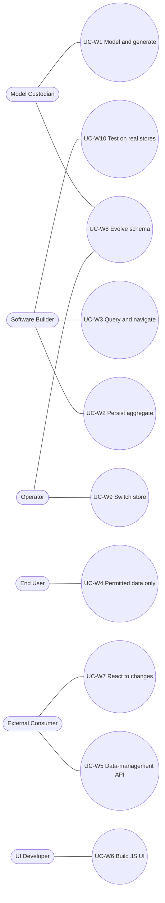

# Use-case catalogue (Cockburn White and Blue)

Change: `soa-python-rdf-orm` · task 6.2 · drivers: [`business-context.md`](business-context.md) · refreshed with round-4 evidence (SoA angles ddd, dx, evolution, lpg; `design-implications.adoc`).

**Reading guide.** Stakeholders read the **White** use cases (UC-W*n*): each is a black-box
contract stated at the C4 Context boundary of the *rdf-persistence ecosystem*, technology-agnostic.
Implementers read the **Blue** use cases (UC-B*n*.*m*): each realises exactly one White use case
over one surface, names the internal responsibilities (supporting actors, see
[`c4-views.md`](c4-views.md) L3), and states **only the deltas**. Actor names are those of
[`business-context.md` §2](business-context.md#2-actors). Candidate technology for each
responsibility is in [`realisation-matrix.md`](realisation-matrix.md), not here.

**Internal responsibilities named in Blue use cases** (the glossary for supporting actors):
Aggregate Session (the unit of work shaped around aggregates: identity map, snapshots, tracking
of the aggregates loaded through its repositories), Repository (one per aggregate root), Mapper
(object ↔ RDF from IRI metadata; owned predicates only), Change Set Compiler (turns the session's
diff into one abstract change set — removed and added triples, version guards, creation guards, an append-only
commit record, outbox records — that a store adapter renders), Query Builder (typed query syntax tree with bound
values, rendered to SPARQL), Field Metamodel (generated typed query vocabulary, e.g. `Person_`),
Store Port (one interface over every store) with its Capability Descriptor (single-request
atomic, multi-request transactions, degraded, named graphs, query language) and Store Adapters,
Policy Enforcement Port (pass-through, scope, change check), Outbox (change records written with
the data), Event Bus (in-process, after commit), Event Relay (external delivery), Code Generator
(templates and boundary checks), Schema Diff and Migration Compiler, Migration Runner,
Data-Management Service (API surface), Client Contract (generated types for the UI), Test Kit
(store fixtures, fakes, graph assertions).

| Id | Name | Primary actor | Blue refinements |
|---|---|---|---|
| [UC-W1](#uc-w1) | Model the domain and generate the application code | Model Custodian | B1.1 runtime mapper · B1.2 generated mapper, routes and client · B1.3 classes declared in code · B1.4 generic service |
| [UC-W2](#uc-w2) | Persist an aggregate in one transaction | Software Builder | B2.1 aggregate session, single guarded operation · B2.2 native transaction · B2.3 capability-driven degradation |
| [UC-W3](#uc-w3) | Query and navigate domain objects | Software Builder | B3.1 load an aggregate by identity · B3.2 filtered, paged list · B3.3 read model |
| [UC-W4](#uc-w4) | Restrict data to what the user is permitted | End User | B4.1 pass-through enforcement · B4.2 scope from a decision engine · B4.3 change check before commit |
| [UC-W5](#uc-w5) | Serve the domain as a data-management API | External Consumer | B5.1 JSON-LD resource API · B5.2 JSON:API with atomic operations |
| [UC-W6](#uc-w6) | Build a JS UI on the data-management API | UI Developer | B6.1 generated typed client · B6.2 graph-direct reads |
| [UC-W7](#uc-w7) | React to changes | External Consumer | B7.1 outbox, bus and relay · B7.2 store or proxy change capture |
| [UC-W8](#uc-w8) | Evolve the schema and migrate data | Model Custodian | B8.1 migration runner · B8.2 migrations from schema diff · B8.3 rehearsal |
| [UC-W9](#uc-w9) | Switch or add a store | Operator | B9.1 add a SPARQL store adapter · B9.2 property-graph adapter (side) |
| [UC-W10](#uc-w10) | Test the application against real stores | Software Builder | B10.1 conformance matrix and test kit · B10.2 service, contract and UI tests |

PlantUML: [`diagrams/uc-overview.puml`](diagrams/uc-overview.puml)

---

## UC-W1: Model the domain and generate the application code

**Use Case Level:** White (Summary) · **Primary Actor:** Model Custodian · **Scope:** rdf-persistence ecosystem

### Stakeholders and Interests
- Model Custodian requires that the model is the single source of truth and that generated code is never edited by hand (AD-5).
- Software Builder requires typed, persistence-free domain classes that already persist (AD-1, AD-13).
- UI Developer requires a client contract derived from the same model (AD-7).

### Brief Description
From a curated model, the ecosystem produces the domain classes and everything the chosen
development approach needs to persist and serve them. The same model always yields the same
output. The RDF mapping (class and property IRIs) travels with the generated classes as metadata,
so domain classes carry no persistence code.

### Preconditions
- A model exists that passes the model quality gate (valid schema, every class and property has an IRI).

### Trigger
The Model Custodian publishes a model version, or a build or test run starts.

### Success Guarantee (Postconditions)
1. Domain classes exist for every model class, typed, persistence-free, carrying their IRIs and their aggregate boundaries (roots, owned and referenced slots).
2. They persist and load through the library with no hand-written mapping.
3. Generation is deterministic: the same model version yields byte-identical output.
4. Validation shapes and the serialisation context derived from the same model are available.

### Minimal Guarantees (On Failure)
1. An invalid model produces a typed report naming the element and the rule; nothing is generated.
2. Previously generated artefacts are left untouched.

### Main Success Scenario
1. Model Custodian submits the model version.
2. System validates the model against the quality gate.
3. System generates the domain classes, shapes and context for the selected approach.
4. System reports the generated artefacts and the model version they trace to.

### Alternate Scenarios
- **Code-first:** the Software Builder declares mapped classes in code instead of a model (UC-B1.3).

### Extensions
2a. A model element has no IRI or an unsupported type — report it; stop. +
2b. Aggregate boundaries cannot be derived or are inconsistent (class owned by two roots, cycle through owned slots) — report the elements; stop (UC-B1.2). +
3a. A target cannot express a model feature (e.g. language-tagged strings) — generate, and report the loss per element.

### Out of Scope
Authoring the model (the modelling toolchain is external); reasoning over the ontology.

### Special Requirements
- Never-edited output: custom behaviour lives outside generated files.

### Technology and Data Variations
Model source: curated schema or a schema imported from shapes (ADR-03). Generation depth: approach A, B or C; or no generation at all, approach D (hand-written classes, code-first) (ADR-08).

### Frequency of Occurrence
On every model change and every build/test run.

### Blue refinements

#### UC-B1.1: Generate domain classes only; map at runtime (approach A)
**Level:** Blue · **Primary Actor:** Model Custodian · **Supporting Actors:** Code Generator (emits classes with IRI metadata); Mapper (reads that metadata at runtime) · **Scope:** ecosystem — build time
Refines [UC-W1](#uc-w1); shared guarantees not restated.
- **Deltas:** only domain classes are generated; the Mapper derives the RDF mapping from class/property IRI metadata on first use and caches it. Repositories are generic (one per aggregate root type, parameterised).
- **Extensions:** 2a. metadata missing at runtime → mapping error naming class and field at import, not at first write.

#### UC-B1.2: Generate mapper, repositories, field metamodel, service routes and client contract (approach B)
**Level:** Blue · **Primary Actor:** Model Custodian · **Supporting Actors:** Code Generator (templates per target; boundary checks); Data-Management Service (receives generated routes); Client Contract (generated types) · **Scope:** ecosystem — build time
Refines [UC-W1](#uc-w1).
- **Deltas:** additionally emits one repository per aggregate root, a typed field metamodel (`Person_.name`) and filter `TypedDict`s for queries, per-class exceptions, `Ref[T]` for references across aggregates, service routes per resource, the service contract and the client types.
- **Boundary derivation** (no composition construct exists in LinkML, K-9): a slot is *owned* if annotated `owned: true`, or by convention `inlined: true` and not `shared`, or if its range has no identifier; *roots* are identified classes never owned, or annotated `aggregate_root: true`; aggregate = root + closure over owned slots; every other identified range is a reference by IRI (ADR-11).
- **Extensions:** 2b. a class owned by two roots, a cycle through owned slots, or an owned entity without derivable IRIs → build fails naming the elements. 2c. a reference from outside an aggregate to a non-root entity → warning.
- **Special:** templates are versioned with the library; regeneration is part of the build (golden tests on generated output).

#### UC-B1.3: Declare mapped classes in code (code-first, approach D)
**Level:** Blue · **Primary Actor:** Software Builder · **Supporting Actors:** Mapper (reads declarations) · **Scope:** rdf-persistence library
Refines [UC-W1](#uc-w1) (alternate scenario).
- **Deltas:** the Software Builder declares classes with IRI annotations; the Mapper treats them exactly like generated classes. The mapper metadata comes from `Annotated` markers and class attributes instead of generated `linkml_meta`. Shapes and context can be exported from the declarations.
- **Trade-offs:** fastest start; no schema single source of truth; no generated SHACL, TS or OpenAPI unless reverse-generated from the classes. Whether the model master is the schema or the code stays open (ADR-03).
- **Extensions:** 1a. a declared field has no IRI → declaration error at import.

#### UC-B1.4: Interpret the model at runtime in a generic service (approach C)
**Level:** Blue · **Primary Actor:** Model Custodian · **Supporting Actors:** Data-Management Service (generic, schema-driven); Mapper · **Scope:** ecosystem — runtime
Refines [UC-W1](#uc-w1).
- **Deltas:** nothing per model is generated; the service loads the model at start and exposes resources. Domain behaviour cannot live in typed classes.
- **Extensions:** 1a. model changes → service reload required.

---

## UC-W2: Persist an aggregate in one transaction

**Use Case Level:** White (Summary) · **Primary Actor:** Software Builder · **Scope:** rdf-persistence library

### Stakeholders and Interests
- Software Builder requires create, update and delete of a whole aggregate with one commit call, and to see what a commit will send (AD-2, AD-13, AD-19).
- End User requires that no concurrent edit silently overwrites theirs (K-2).
- Operator requires that a failed commit never leaves a partial write (K-1, K-7).

### Brief Description
The Software Builder loads an aggregate (a root and the objects it owns), changes it through
domain methods and commits. The library persists all changes of the commit as one atomic change,
or none of them. Objects of other aggregates are referenced by IRI only and are never written by
this commit. How many aggregates one commit may touch is a configurable policy (strict, warn,
allow), not a technical limit. Changes that must reach other aggregates travel as events after
commit (UC-W7).

### Preconditions
- The aggregate's classes and boundaries are mapped (UC-W1). A store is configured (UC-W9).
- Every owned object has an IRI (K-8).

### Trigger
The Software Builder commits a session.

### Success Guarantee (Postconditions)
1. All inserts, updates and deletes of the commit are visible together, or none is.
2. Each touched aggregate's version advances by one; a later commit based on an older version is rejected.
3. Owned objects are deleted with their root; referenced objects are never deleted by it.
4. Only mapped, owned predicates are replaced; triples the model does not own are preserved.
5. A change record per domain event is stored atomically with the data (UC-W7).
6. The change set can be inspected before commit without contacting the store.

### Minimal Guarantees (On Failure)
1. On a version conflict, nothing is written and a typed conflict error names the aggregate, its IRI and both versions.
2. On store failure or timeout, nothing is written; an unknown outcome is resolved on retry by asking the primary for the commit record. On a store that cannot guarantee atomicity, the library refuses unless degraded mode was explicitly enabled, then compensates and reports a degraded commit (ADR-10). It never reports success for a partial write.
3. On a validation failure, nothing is written and the report names object, property and rule.
4. If the caller is not permitted to write, nothing is written (UC-W4).
5. Leaving the session without commit discards the change set; nothing was sent.

### Main Success Scenario
1. Software Builder opens a session.
2. Software Builder loads aggregates through repositories, creates new ones, and changes them through domain methods.
3. Software Builder commits.
4. System diffs every touched aggregate against its snapshot and applies the aggregates-per-commit policy.
5. System validates the changed aggregates against the model's shapes.
6. System checks the change is permitted (UC-W4).
7. System writes the change, its version and creation guards, a commit record and the change records in one guarded operation.
8. System confirms the commit, publishes the domain events in process (UC-W7) and returns the new versions.

### Alternate Scenarios
- **Read-only session:** no changes → commit is a no-op; no version change, no change record.
- **Preview:** the Software Builder prints the change set and leaves without commit (dry run).

### Extensions
4a. Several aggregates touched and policy is `strict` — reject with a boundary error; `warn` — log and continue; `allow` — continue (still one atomic request). +
4b. An owned object has no IRI — mapping error before any store call. +
7a. A version guard fails — conflict error; the session is invalidated; caller reloads and re-applies (a retry decorator may replay the handler). +
7b. Store unavailable or times out — store error; retry checks the commit record first. +
7c. Store splits the request — refuse, or degraded path when enabled (UC-B2.3).

### Special Requirements
- Idempotency: a retried commit is detected by its commit record and not applied twice.
- Authority: the store is the source of truth; the identity map is per session, never shared across users.
- Writers outside the library that do not bump versions are not protected; this is documented.

### Notes and Business Rules
- Aggregates are small; other aggregates are referenced by IRI; consistency outside the boundary is eventual (AD-4, AD-20; DEC-13).
- The version is persistence metadata held by the mapper, not a field of the generated class (ADR-13).

### Technology and Data Variations
Store capability: single-request atomic, multi-request transactional, or degraded (ADR-05, ADR-10). Storage of an aggregate: root + owned closure, or one named graph per aggregate (ADR-09). Aggregates-per-commit policy (ADR-12).

### Frequency of Occurrence
Every write request of every application; tens to thousands per minute (unconfirmed, see business-context §5).

### Blue refinements

#### UC-B2.1: Aggregate session commits one single guarded operation (portable store)
**Level:** Blue · **Primary Actor:** Software Builder · **Supporting Actors:** Repository (loads root + owned closure in one query, keeps the snapshot); Aggregate Session (identity map, tracks the aggregates loaded through its repositories, applies the commit policy); Mapper (diff on owned predicates); Change Set Compiler (one abstract change set); Policy Enforcement Port (optional change check); Store Port + SPARQL Adapter (renders and sends one request, confirms the commit record on the primary); Outbox; Event Bus · **Scope:** rdf-persistence library
Refines [UC-W2](#uc-w2). Sequence: [`c4-views.md` §5.1](c4-views.md#51-commit-an-aggregate).
- **Deltas:** the change set is rendered as **one** `DELETE … INSERT … WHERE` operation whose WHERE joins the version guards of every touched root (a failed guard in a separate operation would not stop the others, K-7). New aggregates are guarded by `FILTER NOT EXISTS` on their root (creation guard). The INSERT carries the new versions, the new owned children, the outbox records and an **append-only commit record** unique to this commit (e.g. `<urn:uuid:T> a rp:Commit ; rp:aggregate <root>`); nothing goes in a separate `INSERT DATA`, which would run even when the guard fails. Zero solutions write nothing. An ASK for that commit record, sent to the **primary** (never a replica), then tells *committed* from *conflict*. A "last transaction" marker is not used: a writer committing right after us would overwrite it and cause a false conflict. On stores that do not serialise guarded updates (on-disk Oxigraph) the adapter takes a write lock around the operation (capability descriptor, K-11). After success: identity map cleared (or kept, configurable), after-commit hooks run, domain events dispatched in process.
- **Extensions:** 7a. commit record absent → `ConcurrencyConflict` (nothing was written). 7b. timeout → on retry, ASK the primary for the commit record first; present → report committed. 7e. a new aggregate's IRI already exists → creation guard fails → `ConcurrencyConflict` (already exists). 4c. a cascade target found only by inbound references → read before commit; references from other aggregates are left (or cleaned up eventually).
- **Special:** behaviour on Oxigraph, Fuseki, GraphDB and Fluree is to be proven by the conformance suite (UC-B10.1) before it is relied on (SoA:angles/ddd: "implemented nowhere yet").

#### UC-B2.2: The same change set inside a native transaction (capability-driven)
**Level:** Blue · **Primary Actor:** Software Builder · **Supporting Actors:** Aggregate Session; Store Port (Capability Descriptor reports `multi_request_tx`); transactional adapter (begin, write, commit/rollback through the store's transaction interface; embedded Fluree `transact(fn)`) · **Scope:** rdf-persistence library
Refines [UC-W2](#uc-w2).
- **Deltas:** the session opens the store transaction on `begin()`; reads inside it see its own writes; the change set may span several requests. No confirming ASK is needed: the transaction outcome (or Fluree's commit receipt) is authoritative. The aggregates-per-commit policy still applies (wider transactions are a temptation, not a licence).
- **Extensions:** 7d. store aborts the transaction or reports a conflict → rollback → same `ConcurrencyConflict` / store errors as W2.

#### UC-B2.3: Capability-driven degradation on a store that splits requests
**Level:** Blue · **Primary Actor:** Software Builder · **Supporting Actors:** Store Port (Capability Descriptor reports `degraded`, e.g. chunking proxy or autocommit); Compensation log · **Scope:** rdf-persistence library
Refines [UC-W2](#uc-w2) minimal guarantee 2.
- **Deltas:** by default the session refuses to start against a degraded store. With `allow_degraded=True` it writes the guard first, records an undo log, and on failure applies the compensations and raises `DegradedCommitError` listing what was undone. Each degraded commit is logged with a warning.
- **Special:** concurrent readers may see partial state; never silent.

---

## UC-W3: Query and navigate domain objects

**Use Case Level:** White (Summary) · **Primary Actor:** Software Builder · **Scope:** rdf-persistence library

### Stakeholders and Interests
- Software Builder requires typed queries without hand-written SPARQL and predictable loading (AD-3, AD-13).
- Operator requires bounded queries (no unbounded fan-out).
- End User requires that only permitted data is returned (UC-W4).

### Brief Description
The Software Builder finds aggregates by identity or by criteria, pages and sorts them, and
navigates their relations to an explicit depth. Every query is built from a typed structure with
bound parameters, never by string concatenation.

### Preconditions
- Classes mapped (UC-W1); store configured.

### Trigger
A call to a repository or query API.

### Success Guarantee (Postconditions)
1. Each IRI maps to at most one object per session.
2. Results contain only objects the caller may read; totals and counts use the same scope.
3. Relations are loaded only to the requested depth, in a bounded number of store requests.
4. Pages are stable for a given order.

### Minimal Guarantees (On Failure)
1. Unknown identity → typed not-found error naming class and IRI.
2. Invalid criteria (unknown property, wrong type) → error at query build time, before any store call.
3. Store timeout → typed store error; no partial page is returned as complete.

### Main Success Scenario
1. Software Builder asks for objects by identity or criteria, with depth, order and page.
2. System builds a typed query and narrows it to the caller's scope (UC-W4).
3. System runs it and maps the results to objects through the identity map.
4. System returns the objects (and the total, when asked).

### Extensions
3a. A loaded object is already in the session → the session instance is returned. +
3b. Data does not match the model (wrong type) → mapping error names IRI and property.

### Special Requirements
- Injection safety: values are always bound, never spliced into query text.

### Technology and Data Variations
Read path: write model, separate read model, or graph-direct read endpoint (UC-B3.3, UC-B6.2).

### Frequency of Occurrence
Dominant traffic; reads typically outnumber writes.

### Blue refinements

#### UC-B3.1: Load an aggregate by identity
**Level:** Blue · **Supporting Actors:** Repository; Aggregate Session (identity map, snapshot); Query Builder (one query along owned predicates); Mapper; Store Port · **Scope:** library
Refines [UC-W3](#uc-w3).
- **Deltas:** the whole aggregate (root + owned closure) is loaded in one query; no lazy loading inside or across aggregates. References to other aggregates come back as `Ref[T]` (an IRI). Explicit loading of related aggregates (`session.load(obj, Person_.member_of)`) batches one query. A *not-loaded* sentinel distinguishes not loaded / loaded and absent / known empty, and is never saved as a deletion.

#### UC-B3.2: Filtered, sorted and paged list
**Level:** Blue · **Supporting Actors:** Query Builder (typed criteria → query tree); Policy Enforcement Port (scope added before paging); Store Port · **Scope:** library
Refines [UC-W3](#uc-w3). Sequence: [`c4-views.md` §5.2](c4-views.md#52-authorized-list-read).
- **Deltas:** the page is selected first (ids), then the objects are constructed for those ids; the count query receives the same scope.

#### UC-B3.3: Query a read model (projection)
**Level:** Blue · **Supporting Actors:** Read Model (typed projection or projection store kept from change events); Query Builder · **Scope:** library + read store
Refines [UC-W3](#uc-w3).
- **Deltas:** reads that cross aggregates go to typed projections (`select(Person).project(PersonCard)`) or a projection store, never through repositories. Projections are read-only by type and can never be saved (that would drop triples). A projection store may lag; results carry its position for read-your-writes.
- **Extensions:** 3c. projection behind the caller's last commit → wait up to a bound or return with a staleness flag.

---

## UC-W4: Restrict data to what the user is permitted

**Use Case Level:** White (Summary) · **Primary Actor:** End User · **Scope:** rdf-persistence ecosystem

### Stakeholders and Interests
- End User requires to see and change only permitted data (AD-12).
- Operator requires one place to manage policy, owned by a borrowed engine, IdP or store (DEC-8).
- Software Builder requires the persistence code to stay free of policy (AD-11).

### Brief Description
Every read and write is limited to what the authenticated user may access. The decision comes
from an external identity provider and decision engine, or from the store's own policies; the
library only applies that decision, and can run with no enforcement at all when an authorizing
proxy or the store does it.

### Preconditions
- The user is authenticated by the identity provider. A policy exists in the chosen engine or store.

### Trigger
Any read or write on behalf of a user.

### Success Guarantee (Postconditions)
1. Reads return only permitted data; lists, totals and single reads use the same scope.
2. Writes outside the permitted scope are rejected before any data changes.
3. Granularity is at least graph level; triple level where the store or proxy supports it.
4. The persistence library holds no policy rules.

### Minimal Guarantees (On Failure)
1. If no decision can be obtained (engine down, timeout), access is denied (fail closed).
2. A denied read of a single object is indistinguishable from not-found, unless configured otherwise.
3. Caches never serve one user's data to another.

### Main Success Scenario
1. End User acts through a client with an identity token.
2. System validates the token.
3. System obtains the user's scope from the decision engine or delegates to the store/proxy.
4. System applies the scope to the query or change (UC-W2, UC-W3).
5. System returns the permitted result.

### Extensions
2a. Token invalid or expired — reject as unauthenticated. +
3a. Decision engine unavailable — fail closed (minimal guarantee 1). +
4a. Free query from the client (graph-direct) — only store-native or proxy enforcement is allowed (UC-B6.2).

### Out of Scope
Implementing a policy engine, an identity provider or a policy language (DEC-8 no-go).

### Special Requirements
- Identity is forwarded only from the validated token, never from unverified headers.

### Technology and Data Variations
Enforcement placement: proxy, store-native, or in-process port (ADR-02); granularity per store.

### Frequency of Occurrence
On every user request.

### Blue refinements

#### UC-B4.1: Pass-through — the store or a proxy enforces
**Level:** Blue · **Supporting Actors:** Policy Enforcement Port (mode `pass-through`: forwards the identity with each store request); Store Port; authorizing proxy or store policies (external) · **Scope:** library
Refines [UC-W4](#uc-w4).
- **Deltas:** the port attaches the user's credential to the request context; the store or proxy filters. The library disables any cross-request cache.
- **Extensions:** 4b. the store rejects a write as forbidden → `PermissionDenied`; nothing written.

#### UC-B4.2: Scope from an external decision engine, applied as graph restriction
**Level:** Blue · **Supporting Actors:** Policy Enforcement Port (mode `scope`); Scope Translator (decision → permitted graphs); Query Builder · **Scope:** library + service
Refines [UC-W4](#uc-w4). Sequence: [`c4-views.md` §5.2](c4-views.md#52-authorized-list-read).
- **Deltas:** the service asks the engine which graphs/resources the user may access; the translator turns the answer into a dataset restriction that the Query Builder adds to every query, including counts.
- **Extensions:** 3b. the scope is empty → empty result, total 0, no store call.

#### UC-B4.3: Check a change set before commit
**Level:** Blue · **Supporting Actors:** Unit of Work (exposes the change set); Policy Enforcement Port (asks the engine per affected aggregate/graph) · **Scope:** library
Refines [UC-W4](#uc-w4) success guarantee 2.
- **Deltas:** after the diff and before the write, the port checks each affected graph or resource; any deny aborts the commit.

---

## UC-W5: Serve the domain as a data-management API

**Use Case Level:** White (Summary) · **Primary Actor:** External Consumer (incl. the UI) · **Scope:** rdf-persistence ecosystem

### Stakeholders and Interests
- UI Developer requires a stable, documented, typed contract usable without RDF expertise (AD-7).
- External Consumer requires the data as JSON-LD with stable IRIs (AD-6).
- Software Builder requires the API to reuse the domain and repositories, not bypass them.

### Brief Description
The ecosystem exposes each aggregate as a resource with create, read, update, delete, list,
filter and page operations, described by a machine-readable contract derived from the model.
Writes go through the domain and the unit of work; reads honour authorization.

### Preconditions
- UC-W1 done for the resources; identity provider reachable.

### Trigger
A client request.

### Success Guarantee (Postconditions)
1. Every model resource is reachable with a documented contract, generated from the model.
2. Representations carry stable IRIs; JSON-LD is available.
3. A write request maps to one commit (UC-W2); a conditional write with a stale version is rejected.
4. Validation failures are reported per property in a machine-readable form.

### Minimal Guarantees (On Failure)
1. Errors use one documented problem format with typed codes (validation, conflict, forbidden, not found, unavailable).
2. A failed write leaves no partial change.

### Main Success Scenario
1. Client sends a request with a token.
2. System authenticates and scopes it (UC-W4).
3. System runs the operation through the repositories (UC-W2/UC-W3).
4. System renders the result in the negotiated representation.

### Extensions
3a. Precondition (version) does not match — conflict response with the current version. +
4a. Requested representation unsupported — negotiation error listing supported ones.

### Technology and Data Variations
Contract style: JSON-LD with a hypermedia vocabulary and an OpenAPI description, JSON:API (semantic.works dialect), GraphQL, read-only query endpoint (ADR-04).

### Frequency of Occurrence
All UI and integration traffic.

### Blue refinements

#### UC-B5.1: JSON-LD resource API with an OpenAPI description
**Level:** Blue · **Supporting Actors:** Data-Management Service (routes, content negotiation); Repository; Unit of Work; Policy Enforcement Port · **Scope:** service
Refines [UC-W5](#uc-w5).
- **Deltas:** compacted JSON-LD with the generated context; hypermedia collection pages with totals; versions exposed as entity tags; conditional writes required for update and delete.

#### UC-B5.2: JSON:API with atomic operations (semantic.works-compatible)
**Level:** Blue · **Supporting Actors:** Data-Management Service (JSON:API dialect); Unit of Work · **Scope:** service
Refines [UC-W5](#uc-w5).
- **Deltas:** resources, relationships and includes follow the semantic.works dialect; an atomic-operations request maps to **one** unit of work, hence one aggregate rule applies (UC-W2 ext. 2a).
- **Extensions:** 3b. operations span aggregates and the store lacks multi-request transactions → reject the batch.

---

## UC-W6: Build a JS UI on the data-management API

**Use Case Level:** White (Summary) · **Primary Actor:** UI Developer · **Scope:** rdf-persistence ecosystem (contract side)

### Stakeholders and Interests
- UI Developer requires typed models, caching, forms and auth with mainstream JS tooling (AD-7).
- End User requires a responsive UI that reflects others' changes (UC-W7).

### Brief Description
The UI Developer consumes the API with generated, typed client code and mainstream libraries.
No RDF knowledge is required for the common path; JSON-LD remains available for the rest.

### Preconditions
- The API contract is published (UC-W5).

### Trigger
The UI Developer starts or updates the UI against a contract version.

### Success Guarantee (Postconditions)
1. Client types and calls are generated from the contract and match it.
2. Validation errors map to form fields.
3. The UI can refresh affected data on change notifications.
4. The UI holds no policy; it only hides what the API reports as forbidden.

### Minimal Guarantees (On Failure)
1. A contract mismatch is caught at build time (generation or type check), not at runtime.

### Main Success Scenario
1. UI Developer generates the client from the contract.
2. UI Developer builds screens on the generated calls and a server-state cache.
3. UI authenticates the End User and sends the token on every call.
4. UI shows data and submits changes with versions.

### Extensions
4a. Conflict on save — UI shows the current version and lets the user merge or retry.

### Technology and Data Variations
Client style follows ADR-04 (typed REST, JSON:API store, graph-direct reads).

### Frequency of Occurrence
Per UI build and contract change.

### Blue refinements

#### UC-B6.1: Generated typed client with a server-state cache
**Level:** Blue · **Supporting Actors:** Client Contract (generated types, calls, mocks); Data-Management Service · **Scope:** UI build
Refines [UC-W6](#uc-w6).
- **Deltas:** types, calls, response validators and test mocks come from the service contract; one authenticated fetch is shared by all libraries; cache keys are IRIs.

#### UC-B6.2: Graph-direct reads from the UI
**Level:** Blue · **Supporting Actors:** Read-only query endpoint behind store-native or proxy enforcement (external); Data-Management Service (all writes) · **Scope:** UI + read endpoint
Refines [UC-W6](#uc-w6).
- **Deltas:** reads use typed graph queries from the browser; writes still go through UC-W5. Backend domain rules do not apply on reads.
- **Extensions:** 2a. no policy-aware endpoint available → this path is not offered (UC-W4 ext. 4a).

---

## UC-W7: React to changes

**Use Case Level:** White (Summary) · **Primary Actor:** External Consumer (subscriber: UI, another aggregate's handler, integration) · **Scope:** rdf-persistence ecosystem

### Stakeholders and Interests
- Subscribers require every committed change, once processed, in commit order per aggregate (AD-10).
- Software Builder requires cross-aggregate rules to run reliably after commit (AD-4).
- End User requires to see only changes they may read (UC-W4).

### Brief Description
Every successful commit produces a change event. Subscribers receive it after the commit, at
least once, in order per aggregate, and can detect gaps. Policies on events mirror read policies.

### Preconditions
- A subscription exists.

### Trigger
A successful commit (UC-W2).

### Success Guarantee (Postconditions)
1. Every committed change yields exactly one event record, durable with the data.
2. Each event is delivered at least once; consumers can deduplicate by event id.
3. Events carry an ordered sequence so consumers can detect gaps and replay.
4. No event exists for a commit that did not happen.

### Minimal Guarantees (On Failure)
1. If delivery fails, events are retained and retried; none is lost.
2. A consumer that falls behind can replay from its last sequence.

### Main Success Scenario
1. System records the change event in the same atomic write as the data.
2. System publishes pending events to the event channel.
3. Subscriber receives the event and processes it.
4. System marks the event as published.

### Extensions
2a. Channel unavailable — retry with back-off; events stay pending. +
3a. Duplicate delivery — subscriber ignores the known event id. +
3b. Subscriber not permitted to read the changed data — event withheld or redacted.

### Technology and Data Variations
Event format: patch format or semantic.works change sets (ADR-06). Source: library outbox or store/proxy capture.

### Frequency of Occurrence
One per commit.

### Blue refinements

#### UC-B7.1: Outbox in the commit, in-process bus, external relay
**Level:** Blue · **Supporting Actors:** domain methods (record domain events on the aggregate); Change Set Compiler (adds one outbox record per event to the single guarded operation); Event Bus (dispatches in process after the commit is confirmed); Event Relay (reads pending records, publishes, marks); Event Channel (external) · **Scope:** library + relay
Refines [UC-W7](#uc-w7). Sequence: [`c4-views.md` §5.3](c4-views.md#53-change-event-propagation).
- **Deltas:** events are durable with the data, so a crash between commit and dispatch loses nothing (in-memory-only dispatch, as in cosmic-python, would). Handlers that change *other* aggregates open *new* sessions (eventual consistency). External delivery is at least once. Whether both bus and relay are shipped is open (ADR-14).

#### UC-B7.2: Store or proxy change capture
**Level:** Blue · **Supporting Actors:** store's change feed or authorizing proxy's delta notifier (external); Event Relay (adapter to the channel) · **Scope:** relay
Refines [UC-W7](#uc-w7).
- **Deltas:** no outbox; events come from the store (head-moved notice + pull) or the proxy (change sets). Ordering and completeness are those of the source; domain-event semantics are lost (only triple deltas).

---

## UC-W8: Evolve the schema and migrate data

**Use Case Level:** White (Summary) · **Primary Actor:** Model Custodian · **Scope:** rdf-persistence ecosystem

### Stakeholders and Interests
- Model Custodian requires model changes to propagate to code, shapes and data (AD-17).
- Operator requires migrations that are reviewed, ordered, recorded, checksummed, locked against concurrent runs and safe to re-run.
- UI Developer requires a contract change to be visible as a version.
- End User requires that authorization is not bypassed: migrations run as a dedicated, permitted service identity (DEC-8).

### Brief Description
A new model version is released and regenerated (UC-W1). The difference to the previous version
yields migration scripts: mechanical changes (renamed IRIs, new defaults) are generated,
destructive ones are gated, reshapes are scaffolded for a human. After review, the runner applies
pending scripts in order through the same store port as the application, records each in the
store, and validates the data against the new version's shapes. There is no DDL: evolution is
data transformation plus shape installation.

### Preconditions
- The new model version passes the quality gate. The migration identity is permitted by the policy in force.

### Trigger
A model version is released, or an Operator runs the migrate command.

### Success Guarantee (Postconditions)
1. Each migration runs once per store, in order, and is recorded with its checksum.
2. After migration, the stored data conforms to the new shapes, or the report lists the non-conforming nodes.
3. The service contract version changes when the model's public shape changes.
4. Destructive changes run only with explicit confirmation.

### Minimal Guarantees (On Failure)
1. A failed step leaves its own scope unchanged (atomic per step) and stops the sequence; the log shows the last applied step.
2. An already applied script whose checksum changed is refused.
3. A second runner on the same store waits or fails on the lock; it never runs steps twice.

### Main Success Scenario
1. Model Custodian releases the model version.
2. System regenerates code, shapes and contract.
3. System derives migration scripts from the schema difference and marks each as generated, gated or to-be-completed.
4. Model Custodian reviews and completes the scripts.
5. Operator runs the migrations.
6. System applies pending scripts in order, recording each, and validates the data against the new shapes.

### Alternate Scenarios
- **Hand-written migration:** no generator (step 3 skipped); scripts authored directly.
- **Rehearsal:** the migration runs first on a branch or inside a transaction, is validated, then merged or committed (store-dependent).

### Extensions
3a. A slot is removed — the delete script is generated but gated: it runs only when confirmed. +
3b. Cardinality, range or datatype change, class split or merge — a scaffold is generated; a human completes it (or writes an object-level mapping spec). +
3c. A constraint is only tightened — no data change; the shape report lists violators. +
6a. A step is larger than the store accepts in one request — run it in stated, idempotent batches. +
6b. A step fails — stop; report the step and the store response.

### Out of Scope
Down migrations generated automatically (reviewed `.down` scripts only); rewriting other contexts' data.

### Special Requirements
- Each script runs per named graph (or across `GRAPH ?g`) as the data layout requires.
- The run log lives as triples in an administrative graph, file-compatible with the semantic.works migrations format where V2 needs it.

### Frequency of Occurrence
Per model release; also on LinkML or library upgrades that change generated output.

### Blue refinements

#### UC-B8.1: Run reviewed migrations with the migration runner
**Level:** Blue · **Primary Actor:** Operator · **Supporting Actors:** Migration Runner (ordered `NNNN-<slug>.sparql` files, checksum, lock, run log in an admin graph); Store Port (same adapter as the app); Policy Enforcement Port (runner authenticates as a service principal); Shape Validator (new version's shapes) · **Scope:** ecosystem operations
Refines [UC-W8](#uc-w8). Sequence: [`c4-views.md` §5.4](c4-views.md#54-run-schema-migrations).
- **Deltas:** the runner is an entrypoint (`make migrate`) over the store port, not a bypass inside the library; the lock and log are triples guarded like any commit; validation runs after the last step.

#### UC-B8.2: Derive migration scripts from the schema difference
**Level:** Blue · **Primary Actor:** Model Custodian · **Supporting Actors:** Schema Diff (two LinkML versions; uses deprecation and exact-replacement hints); Migration Compiler (mechanical changes → SPARQL Update; destructive → gated; reshapes → scaffold) · **Scope:** ecosystem build time
Refines [UC-W8](#uc-w8) step 3.
- **Deltas:** `slot_uri` / `class_uri` / enum meaning changes and new required slots with defaults compile automatically; everything else is gated or scaffolded. Whether this compiler is in the first EPIC is open (ADR-16).

#### UC-B8.3: Rehearse a migration (store-dependent)
**Level:** Blue · **Primary Actor:** Operator · **Supporting Actors:** Migration Runner; store branch (ledger store) or store transaction (vendor-transactional store) · **Scope:** ecosystem operations
Refines [UC-W8](#uc-w8) alternate scenario "Rehearsal".
- **Deltas:** on a ledger store the runner migrates a branch, validates, then merges; on a vendor-transactional store each step runs in one transaction with a real rollback.

---

## UC-W9: Switch or add a store

**Use Case Level:** White (Summary) · **Primary Actor:** Operator · **Scope:** rdf-persistence library

### Stakeholders and Interests
- Operator requires changing the store by configuration (AD-9).
- Software Builder requires domain and repository code to stay unchanged (AD-8).

### Brief Description
The store is selected by configuration. Each store states its capabilities (atomicity,
transactions, history, authorization); the library uses the strongest available and reports
what it cannot guarantee.

### Preconditions
- An adapter exists for the store kind.

### Trigger
Configuration change or new deployment.

### Success Guarantee (Postconditions)
1. Domain, repository and service code run unchanged.
2. The active capability set is reported at start-up.
3. Guarantees of UC-W2 hold, or the deviation is stated (UC-B2.3).

### Minimal Guarantees (On Failure)
1. An unreachable or incompatible store stops start-up with a clear error.

### Main Success Scenario
1. Operator configures the store.
2. System connects, probes capabilities and reports them.
3. System serves requests through the matching adapter.

### Extensions
2a. A required capability is missing — refuse to start, or start degraded per policy (ADR-10).

### Technology and Data Variations
Embedded, remote SPARQL, vendor-transactional, ledger (Fluree), property graph (side).

### Frequency of Occurrence
Rare (per deployment).

### Blue refinements

#### UC-B9.1: Add a SPARQL store adapter
**Level:** Blue · **Supporting Actors:** Store Port (capability descriptor); Store Adapter; conformance suite (UC-B10.1) · **Scope:** library
Refines [UC-W9](#uc-w9).
- **Deltas:** an adapter declares its capabilities and passes the shared conformance suite before it is listed as supported.

#### UC-B9.2: Add a property-graph adapter (side question)
**Level:** Blue · **Supporting Actors:** Store Port (Capability Descriptor: query language, named graphs absent or emulated, edge properties); Property-Graph Adapter (renders the abstract change set as one graph-database transaction; renders the query tree to the graph query language); projection config (which classes are nodes or relationships; IRI → label/key naming) · **Scope:** library
Refines [UC-W9](#uc-w9).
- **Deltas:** possible only because the change set and query tree are abstract and raw SPARQL lives on its own port (AD-21). Named graphs and language tags need a stated encoding or are unsupported. Estimated effort: medium for CRUD fidelity, high for full RDF round-trip (SoA:angles/lpg). A cheaper route is a store that serves both models over the same data (no adapter).
- **Extensions:** 3a. a query feature has no property-graph equivalent → `UnsupportedByStore` at build time.

---

## UC-W10: Test the application against real stores

**Use Case Level:** White (Summary) · **Primary Actor:** Software Builder · **Scope:** rdf-persistence ecosystem

### Stakeholders and Interests
- Software Builder requires fast tests in-process and confidence on the production store (AD-16).
- QA requires Gherkin scenarios run end to end (mwb2 L37).

### Brief Description
The same tests run against an in-memory store, an embedded store and disposable instances of
the production stores; UI tests run against generated mocks and against the live service.

### Preconditions
- Test configuration names the store targets.

### Trigger
A test run (local or CI).

### Success Guarantee (Postconditions)
1. Each store target runs the same scenarios; differences are reported by capability.
2. Each test starts from a known, isolated dataset.

### Minimal Guarantees (On Failure)
1. A store target that cannot start is reported as skipped with the reason, never as passed.

### Main Success Scenario
1. Software Builder runs the tests.
2. System provisions each store target and loads fixtures.
3. System runs the scenarios and reports per target.

### Frequency of Occurrence
Every commit (CI).

### Blue refinements

#### UC-B10.1: Store conformance matrix and test kit
**Level:** Blue · **Supporting Actors:** Test Kit (pytest plugin: in-memory store per test, LinkML-driven fake builder, graph-isomorphism asserts); conformance suite (the SPARQL subset the mapper emits, incl. the single guarded operation); Store Adapters; disposable store containers; fault-injection proxy · **Scope:** library tests
Refines [UC-W10](#uc-w10).
- **Deltas:** one suite × N stores (Oxigraph, Fuseki, GraphDB Free, Fluree, Virtuoso), marked per capability; fault injection proves atomic-commit and compensation behaviour on dropped connections. No store container module exists upstream, so the library ships the fixtures. The in-memory store runs the same SPARQL as production. Docs examples run in CI.

#### UC-B10.2: Service, contract and UI tests from Gherkin
**Level:** Blue · **Supporting Actors:** Client Contract (generated mocks); Data-Management Service; Gherkin runner on the same test runner as unit tests; property-based contract tester on the generated OpenAPI · **Scope:** service and UI tests
Refines [UC-W10](#uc-w10).
- **Deltas:** service BDD runs on the unit-test runner (shared fixtures, coverage counted); the API contract is fuzzed for 500s and drift; component tests use generated mocks; UI end-to-end tests run Gherkin against the live service on a disposable store; authorization is tested with real engine/IdP containers or a stub key set.
