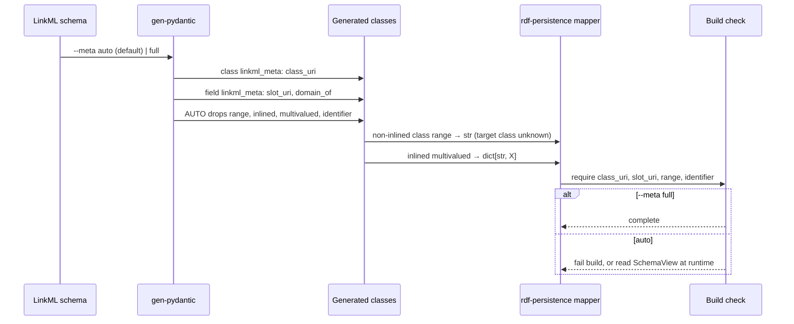
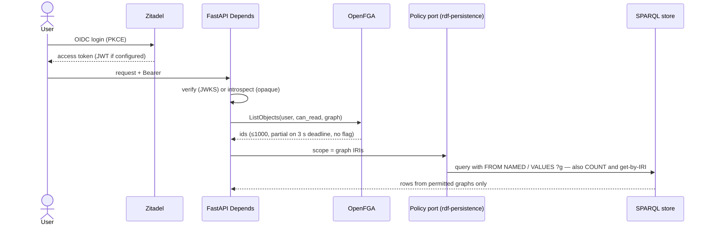
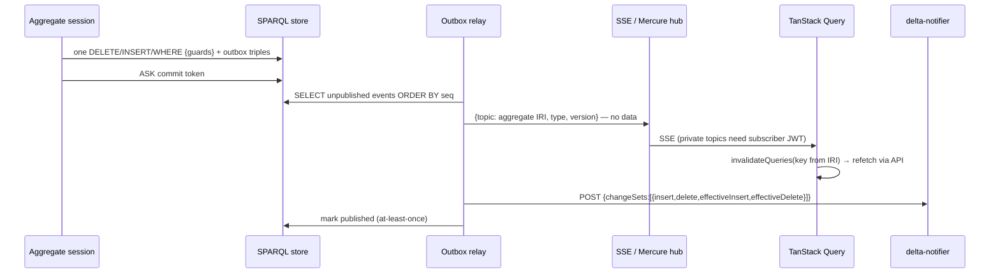
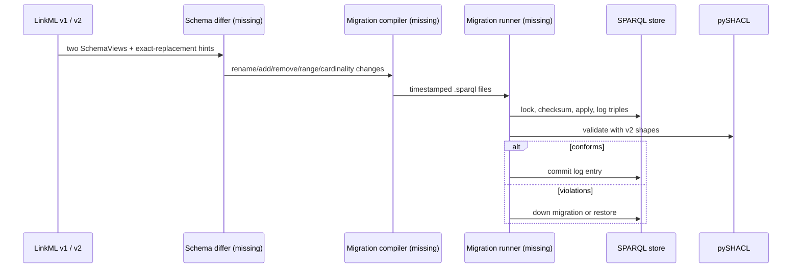

# Angle (round 5): integration seams, licences and ecosystem risks

Analyst: angle-integration, 2026-11-03. Brief: BRIEF-round3.md (goal, DEC-4/5/8, L0–L6) and
BRIEF-round5.md. Read before writing: index.adoc, building-blocks.adoc, variants.adoc,
design-implications.adoc, catalogue.adoc, angle-codegen.md, angle-evolution.md.

Evidence base: source code of the siblings in /home/lps/work/repos/ (linkml @ d48b197
2026-10-30, schema-automator @ 0cf0e88, ldkit @ 09fc801, shacl-form @ 5f430f5, jsonld.js @ 7a93609,
openfga @ 2dfa5d3, fluree-db @ 807902b, delta-notifier @ 2fac0f5, api-platform-core, sparql-parser),
GitNexus (`context -r db resolve_options`, `context -r linkml _build_ignored_properties`,
`query -r openfga`), orval's zod generator (`packages/zod/src/index.ts`, master, fetched to
`temp/orval-zod.ts`), Zitadel claims docs (WebFetch), and `gh api` for licences, stars and
contributors (2026-11-03). Statements not checked in code are marked *(doc)* or *(not verified)*.
Nothing was installed or run.

Verdict scale: **works** (hand-off works today with configuration only) · **fix** (works with a
known, bounded fix that we own: a flag, a template, a post-processor, a convention) ·
**missing** (a component that does not exist must be built).

PlantUML versions of every diagram: `integration-diagrams/<chain-slug>.puml` (all nine pass
`plantuml -checkonly`).

---

## Part 1 — Integration paths

### Summary

| # | Chain | Verdict | What breaks, in one line |
|---|---|---|---|
| C1 | UML → model2owl → SHACL → schema-automator → LinkML | **fix** | Lossy import: `sh:sparql`, ranges, patterns, paths, lang tags dropped; `identifier` only on opt-in; no aggregate info |
| C2 | LinkML → gen-pydantic → runtime mapper | **fix** | Default `--meta auto` drops `range`, `inlined`, `multivalued`, `identifier`; reference slots become bare `str` |
| C3 | LinkML → JSON-LD context + frame → jsonld.js | **fix** | No `@language` container; `@index` (not `@id`) for inlined dicts; frame only for one root |
| C4 | LinkML → OpenAPI → orval / hey-api → TS + zod | **fix** | `paths` are hand-written; FastAPI's own OpenAPI leaks `linkml_meta`; `uriorcurie`/references are plain strings |
| C5 | LinkML → gen-shacl → LDkit / shacl-form / pySHACL gate | **fix** | `sh:closed true` rejects persistence bookkeeping; `sh:class` on references fails on an aggregate-only data graph; no lang strings for LDkit |
| C6 | Zitadel → FastAPI → OpenFGA ListObjects → SPARQL graph scope | **fix** (port **missing**) | ListObjects truncates at 1 000 and on a 3 s deadline without a flag; the scope-injecting port does not exist |
| C7 | Zitadel → Fluree identity / policy class | **fix** | Fluree needs `fluree.*` custom claims and JWT access tokens; trusted-app mode lets the credential holder impersonate anyone |
| C8 | UoW + outbox → relay → SSE/Mercure → TanStack Query; → semantic.works deltas | **missing** (relay and outbox), formats **works** | No outbox or relay exists; deltas carry quads only (no aggregate, tx or version) |
| C9 | LinkML schema diff → migration → SPARQL Update → SHACL gate | **missing** | No LinkML schema diff, no SPARQL migration compiler, no safe RDF migration runner; only the last step (pySHACL) exists |

---

### C1 — UML / model2owl → SHACL → schema-automator → LinkML

```mermaid
sequenceDiagram
  participant UML as EA UML (XMI)
  participant M2O as model2owl (XSLT)
  participant SA as schemauto import-shacl
  participant LML as Curated LinkML overlay
  participant GS as gen-shacl
  participant EQ as Equivalence check (CI)
  UML->>M2O: XMI (SEMIC conventions)
  M2O->>M2O: conventions report (SVRL) gate
  M2O->>SA: OWL + SHACL (targetClass, class, datatype, in, sparql)
  SA->>SA: drop sh:sparql, minInclusive, pattern, paths; langString → string
  SA->>LML: classes (class_uri), slots (slot_uri); identifier only with --identifier
  LML->>LML: add identifier, aggregate annotations, lang-string convention, enum meaning
  LML->>GS: regenerate
  GS->>EQ: LinkML SHACL (sh:closed true)
  M2O->>EQ: model2owl SHACL
  EQ-->>LML: drift report
```

**Verdict: fix.** The hand-off runs today; what arrives is a *bootstrap*, not a round trip.

What survives (code):
- `class_uri` from the shape's target class (`shacl_import_engine.py:325`), `slot_uri` from
  `sh:path` (`:379`), cardinality → `required` / `multivalued` (`:555-569`), `sh:in` → enums with
  `meaning` IRIs (`:534, :722`), split shapes merged (laxest bound across files, `:571`).

What breaks (code, documented by the importer itself at `shacl_import_engine.py:35-110`):
- **Constraints lost:** `sh:sparql` (all multi-hop invariants), `sh:minInclusive/maxInclusive`
  (LinkML has `minimum_value` — "the clearest gap"), `sh:pattern`, sequence/alternative paths,
  `sh:severity`/`sh:message`. Validation must stay on model2owl's SHACL, not on the round-tripped
  LinkML SHACL.
- **Types lost:** `rdf:langString` → `string` (`:501`); model2owl emits `rdf:langString`
  (`elements-shacl-shape.xsl:282`, angle-codegen §3). The language tag disappears at the first
  hop and nothing downstream can bring it back.
- **Identifiers:** SHACL has no identifier concept; `identifier` is added only on request
  (`--identifier`, `:842-970`). Without it every class range is *inlined* by gen-pydantic
  (`pydanticgen.py:766`: no identifier slot ⇒ inlined) — every reference becomes a nested object.
  This is the first silent break between C1 and C2.
- **`sh:node` treated as `sh:class`** (To-do list in the importer) — wrong for arbitrary shapes.
- **Aggregates:** neither SHACL nor LinkML carries composition; boundaries need annotations added
  in the overlay (index: B1).
- **model2owl's own LinkML exporter** stays off-trunk (fork branch, 365 commits behind; no enum
  `meaning`, lang strings flattened) — do not use it.

Fix we own: an overlay step (curated LinkML that imports the generated one, or a scripted patch)
that adds `identifier`, aggregate annotations, the lang-string convention and missing bounds; a CI
gate that compares model2owl SHACL with LinkML `gen-shacl` output and lists the expected drops
(G29/G30 proposals in angle-codegen). Decision still open (index, "Model source"): which is
master after UML.

---

### C2 — LinkML → gen-pydantic (`metadata_mode`) → runtime mapper



**Verdict: fix** (one generator flag plus a build check).

Evidence (`packages/linkml/src/linkml/generators/pydanticgen/`):
- Modes: `MetadataMode` FULL / EXCEPT_CHILDREN / AUTO / NONE (`pydanticgen.py:104-121`), default
  AUTO (`:321`), CLI `--meta` (`:1383`).
- AUTO excludes every key that is a field of the template model plus `meta_exclude`
  (`common/template.py:66-73`). For attributes that is `range`, `inlined`, `inlined_as_list`,
  `owner`, `from_schema` (`template.py:191`) **and** `required`, `identifier`, `key`,
  `multivalued`, `pattern`… (fields of `PydanticAttribute`, `template.py:193-212`). So in AUTO the
  per-field `linkml_meta` keeps `slot_uri` and `domain_of`, while the class keeps `class_uri`.
- **The real break:** a non-inlined class range is typed with the target's identifier type, i.e.
  `str` (`pydanticgen.py:753-802`, `range_cls_identifier_slot_range = "str"`). With `range`
  dropped from metadata, a mapper cannot tell "IRI reference to `Person`" from "plain string
  literal" — it would write `"ex:p1"` as a literal. `identifier=True` only surfaces as a
  required field (`Field(default=...)`, `template.py:220-224`), indistinguishable from any other
  required field.
- Inlined multivalued slots become `dict[str, X]` keyed by the identifier
  (`pydanticgen.py:634-652`); the mapper must handle the dict form, not only lists.
- URIs are `str` (no `AnyUrl`); confirmed in earlier rounds, unchanged.

Fix we own: generate with `--meta full` (or `except_children`) **and** a build check that every
field has `slot_uri` + `range` and every class has `class_uri` + one identifier (taxonomy G28/G33
area). Alternative: the mapper loads `SchemaView` from the schema at runtime and ignores
`linkml_meta` — no generator change, but one more runtime dependency and two sources of truth.

---

### C3 — LinkML → gen-jsonld-context (+ frame) → JSON-LD on the wire → jsonld.js

```mermaid
sequenceDiagram
  participant GC as gen-jsonld-context
  participant SVC as FastAPI (rdflib + PyLD)
  participant UI as Browser (jsonld.js)
  participant CMP as Components
  GC->>SVC: context: class range @type @id; enum @vocab (if meaning)
  GC->>SVC: --emit-frame: root @type, @embed @always/@never
  SVC->>SVC: graph → JSON-LD → PyLD frame
  SVC->>UI: application/ld+json, context by URL
  UI->>UI: jsonld.frame/compact with the same context
  UI->>CMP: plain objects
  Note over GC,CMP: no @language container; lang values arrive as {@value,@language}
```

**Verdict: fix.**

Evidence (`jsonldcontextgen.py`):
- Class ranges → `"@type": "@id"` (`:378-379`); identifier slot → `"@id"` (`:361-362`); enums
  get `@type: @vocab` only when every permissible value has a `meaning` in one namespace
  (`_vocab_eligible_enum`, `:305-340`), otherwise a scoped SKOS context — so enum values from C1
  without `meaning` arrive as plain strings, not concept IRIs.
- **No `@container: @language`** anywhere in the generator (grep: no hit; `language_tags.py` is
  used only by owlgen and shaclgen). Language-tagged literals compact to `{"@value", "@language"}`
  objects, so a UI that expects `string` breaks, and a language map (design-implications: the
  `LangString` option) needs a hand-written context patch.
- `--fix-multivalue-containers` (off by default, `:54`) emits `@container: @index` for inlined
  dicts (`:403-407`). `@index` keys carry no semantics; LinkML's dict key *is* the identifier, so
  the right container is `@id`. With the flag on, IRIs of inlined children can be lost on expansion
  (they become blank nodes if the object omits the id). Keep the flag off, or patch to `@id`.
- Frame: one root type (`tree_root` or `--frame-root`, `:229, :275`) with `@embed` per slot from
  `inlined` (`:425`). One frame per resource type must be generated for a multi-resource API.
- jsonld.js (BSD-3, 9.0.1-0, last push 2026-03-04) supports language containers (`compact.js:536`)
  and 1.1 framing with `@embed` `@always/@never/@once` (`frame.js:129-160`): the browser side is
  fine once the context is right.
- PyLD (server framing) passes DEC-5 but releases slowly; framing large graphs in Python is
  slow *(not measured)*.

Fix we own: a context post-processor (lang-string slots → `@container: @language`; inlined dicts
→ `@id`), one frame per resource, enum `meaning` required by the C1 overlay.

---

### C4 — LinkML → OpenAPI → orval / hey-api → TS types + zod

```mermaid
sequenceDiagram
  participant LML as LinkML schema
  participant GO as gen-openapi (template paths)
  participant FA as FastAPI /openapi.json
  participant GEN as orval / hey-api
  participant TS as TS client + zod
  LML->>GO: components only; paths from a hand-written template
  GO->>GEN: 3.0.3: uri → format uri, dates → format date, enums
  GO->>GEN: 3.1.0: via Pydantic, linkml_meta stripped
  LML->>FA: generated Pydantic classes in routes
  FA->>GEN: linkml_meta leaks; IRIs plain string; Optional → anyOf null
  GEN->>TS: enum unions; date → zod date or Date; uri → z.url()
```

**Verdict: fix.** This chain sidesteps `gen-typescript`'s enum/date bugs (index), because orval
and hey-api read JSON Schema `enum` and `format` directly.

Evidence:
- `gen-openapi` composes a **user-provided template** holding `paths` and security with generated
  `components` (`openapigen.py:98-118`); 3.0.3 goes through `JsonSchemaGenerator` with
  `uri → {string, format: uri}`, `xsddate → date`, `xsddatetime → date-time`
  (`jsonschemagen.py:49-61`); 3.1.0 goes through `PydanticGenerator` + `model_json_schema` and
  strips `linkml_meta` (`openapigen.py:336-345`). Routes are not generated (gap G9 stands).
- FastAPI's runtime `/openapi.json` built from the same classes carries
  `json_schema_extra.linkml_meta` (attribute template, `attribute.py.jinja` last line) — orval
  ignores unknown keys *(not verified for hey-api)*, so it is noise, not breakage; but it
  publishes internal metadata to clients.
- orval zod (`packages/zod/src/index.ts`): `format: date` → date validator (`:2041-2045`),
  `date-time` → datetime with options (`:2059-2069`), `uri` → `url()` (`:2078-2080`); `useDates`
  turns them into `Date` (`:2734`).
- Gaps that remain: `uriorcurie` has no format (`jsonschemagen.py:790` falls to `string`), so
  CURIE-valued fields are unchecked strings; in the 3.1.0 path even `uri` loses `format` (Pydantic
  `str`); `decimal` → `number` (precision loss in JS); references to other resources are plain
  strings with no link to the target schema; lang strings have no shape at all.

Fix we own: publish the `gen-openapi` output (or strip `linkml_meta` in FastAPI's
`openapi()` override), prefer the 3.0.3 path for formats until the Pydantic template emits
`AnyUrl`, add `x-` hints or a `format: iri` convention for references, and generate the `paths`
template ourselves (approach B).

---

### C5 — LinkML → gen-shacl → LDkit / shacl-form, and pySHACL at commit time

```mermaid
sequenceDiagram
  participant GS as gen-shacl
  participant LDK as LDkit shacl_to_schema
  participant SF as shacl-form
  participant UOW as UoW commit
  participant PS as pySHACL
  participant ST as SPARQL store
  GS->>LDK: NodeShape per class; sh:class + nodeKind IRI; sh:in; counts
  LDK->>LDK: sh:class → @id; langString → @multilang (never emitted)
  GS->>SF: same shapes; sh:name/order; pickers need class instances
  UOW->>PS: aggregate subgraph + bookkeeping triples
  PS->>PS: sh:closed rejects version/token predicates
  PS->>PS: sh:class on refs needs rdf:type of referenced IRIs
  alt conforms
    UOW->>ST: one guarded SPARQL Update
  else violations
    PS-->>UOW: report → field errors
  end
```

**Verdict: fix** — and the commit-gate break is the most likely to bite first.

Evidence:
- `gen-shacl` defaults to **`sh:closed true`** for every concrete class (`shaclgen.py:97,
  232-238`; CLI `--closed/--non-closed`, `:880`). `sh:ignoredProperties` contains only `rdf:type`
  and properties of subclasses (`_build_ignored_properties`, `:845-868`; GitNexus
  `context -r linkml _build_ignored_properties`). A version triple, a commit token or any
  annotation on the aggregate root that is not a schema slot **fails validation**. Any triple
  another application adds to the same subject also fails (closed world vs open world).
- For a class range the generator emits `sh:class <Target>` plus `sh:nodeKind sh:IRI`
  (`shaclgen.py:409-417`). `sh:class` requires `?ref rdf:type Target` **in the data graph**.
  Validating only the aggregate's own triples (the natural UoW choice) fails every reference to
  another aggregate. Validating the whole store is too slow per commit.
- LDkit `scripts/shacl_to_schema.ts` (598 lines): `sh:class`/`sh:node` → `@id` (`:338-342`),
  `rdf:langString` or `sh:uniqueLang` → `@multilang` (`:337`), `sh:in` → enum values, counts →
  `@optional` / `@array` (`:366-372`). LinkML never emits `rdf:langString`, so LDkit never gets
  multilingual fields. Works otherwise; LDkit fails DEC-5 (83★, 95 % one author).
- shacl-form reads `sh:class` and fills pickers from class instances it can see
  (`src/constraints.ts:209`, `util.ts:299`), language widgets from `sh:languageIn`
  (`theme.default.ts:155`). LinkML emits `sh:name`/`sh:order`/`sh:description`
  (`shaclgen.py:291-294`) — good labels; it emits `sh:languageIn` only through
  `--default-language` *(not traced end-to-end)*.

Fix we own: generate commit-gate shapes with `--non-closed` or post-process
`sh:ignoredProperties` with the bookkeeping predicates; keep bookkeeping off the root subject
(a separate `<root>#meta` node or an admin graph); for references either load `rdf:type` of
referenced IRIs with the aggregate (one extra VALUES query) or derive a commit-time shape set
that replaces `sh:class` by `sh:nodeKind sh:IRI` and checks reference types in a nightly full
validation. Keep model2owl SHACL for full validation (C1).

---

### C6 — Zitadel token → FastAPI → OpenFGA ListObjects → SPARQL graph scope



**Verdict: fix** for the components, **missing** for the policy port itself (gap in index).

Evidence:
- Zitadel *(doc, WebFetch of /docs/apis/openidoauth/claims)*: roles in
  `urn:zitadel:iam:org:project:roles` (or the per-project variant) shaped as
  `{role: {orgId: orgDomain}}` — a map, not a list; included in access tokens **only when the
  token is a JWT and roles are requested or configured**. Opaque tokens need introspection per
  request (latency, cache). The default token type was not stated on the page.
- OpenFGA `pkg/server/config/config.go:27-28`: `DefaultListObjectsDeadline = 3s`,
  `DefaultListObjectsMaxResults = 1000`; `commands/list_objects.go:355` caps at 1 000 even if
  configured higher; `:489` "TODO set header to indicate deadline exceeded" — **partial results
  are returned without a signal**. `StreamedListObjects` (`pkg/server/list_objects.go:213`) has no
  cap. Consequence: a user with more than 1 000 readable graphs, or a slow model, silently sees
  fewer data (fail-closed, but wrong totals and confused users).
- The leak trap (index anti-patterns, rdfproxy): every generated query — list, **count**,
  **single item by IRI**, grouped rows, include/eager-loading sub-queries, exports, the SPARQL
  escape hatch — must carry the same scope. A get-by-IRI that skips the scope reveals existence
  (404 vs 403, AZ33).
- SPARQL side: graph scope by `FROM NAMED`/`GRAPH ?g` + `VALUES ?g {…}` works on every SPARQL
  1.1 store; very long `VALUES` lists hurt some stores *(not measured)*.

Fix we own: the policy port (pass-through / graph-scope / forward identity), a scope cache per
request, StreamedListObjects or a "graph groups" relation to keep lists short, a contract test
that runs every repository method under a scoped user and checks counts and single-item reads
(taxonomy AZ30 proposal), JWT access tokens with role assertion configured in Zitadel.

---

### C7 — Zitadel roles → Fluree identity / policy class → policy-filtered SPARQL

```mermaid
sequenceDiagram
  participant Z as Zitadel
  participant API as FastAPI service
  participant FL as Fluree server
  participant LG as Ledger (policies as RDF)
  Z->>API: user token (sub, roles claim)
  API->>API: roles → policy-class IRIs; sub → identity IRI
  Z->>API: service-account JWT + custom claims (Zitadel Action)
  API->>FL: SPARQL + Bearer(service) + fluree-identity + fluree-policy-class
  FL->>FL: JWKS verify; CredentialPolicy::Request trusts headers
  FL->>LG: identity → f:policyClass; load policies
  LG-->>FL: filtered reads / checked writes
  FL-->>API: policy-filtered results
```

**Verdict: fix.** Works with Zitadel custom claims and a strict credential discipline.

Evidence (fluree-db @ 807902b, GitNexus repo `db`):
- Bearer tokens are verified against JWKS (`fluree-db-server/src/jwks.rs`, `token_verify.rs`,
  issuer must match signer `:68-95`). Claims read (`fluree-db-credential/src/jwt_claims.rs`):
  `sub`, `fluree.identity`, `fluree.ledger.read.all|ledgers`, `fluree.ledger.write.all|ledgers`,
  `fluree.events.*`, `fluree.policy` (object = fixed policy, or the string `"request"`).
  Data access is refused unless the read/write scope claim covers the ledger
  (`extract/data_bearer.rs:55-65`). **Zitadel does not emit `fluree.*` claims** — a Zitadel Action
  (custom claims) or a Fluree-native credential is required *(Zitadel Actions: doc knowledge, not
  verified this round)*. No token introspection on the data path (introspect appears only in
  graphql and peer code), so access tokens must be JWTs.
- Policy selection (`extract/credential_policy.rs:30-46`, GitNexus `context -r db
  resolve_options`): `Request` → the request's `fluree-identity`, `fluree-policy-class`,
  `fluree-policy-values`, `fluree-default-allow` headers are trusted as sent; `Fixed` → the claim's
  policy constrains the request; `ScopeOnly` → no selection. Header names in
  `extract/headers.rs:288-297`; `fluree-identity` "is policy evaluation context … which a caller
  may set" (`:199-202`).
- So the MWBv2 shape "trusted application credential" = a service JWT with
  `fluree.policy: "request"` plus scope claims; the service maps Zitadel roles to policy classes
  per request. **Whoever holds that credential can act as any identity, and can send
  `fluree-default-allow: true`** — the same trusted-header trap as `sparql-parser`
  (index anti-patterns). The identity IRI must exist in the ledger with `f:policyClass` triples,
  so Zitadel users/roles must be mirrored into the ledger, or policy classes passed per request.
- Named graphs: policies target properties/classes/subjects; per-graph only via
  `f:graphOverrides` (stores angle, confirmed round 4).

Fix we own: a Zitadel Action adding the `fluree.*` claims to the service account's token; the
service never forwards client-supplied `fluree-*` headers (strip at the edge); a role→policy-class
mapping table generated from the model (AZ29); prefer `Fixed` credentials per role where the
number of roles is small. Legal check of BUSL-1.1 first (Part 2).

---

### C8 — UoW commit with outbox → relay → SSE/Mercure → TanStack Query; → semantic.works deltas



**Verdict: missing** for the outbox writer and the relay; **works** for the transport formats.

Evidence:
- No outbox exists in any reviewed Python mapper or store (catalogue: "Application-level outbox —
  pattern, no RDF implementation found"). API Platform publishes Mercure updates in Doctrine's
  `postFlush` (`PublishMercureUpdatesListener.php:101-147`) — after commit, in process, so a crash
  between commit and publish loses the event; it sends only IRI + type for deletions
  (`:241`) and supports `private` updates (`:53, :324`). This is the precedent to improve on.
- delta-notifier ingests `POST /` with `{changeSets: [{insert, delete, effectiveInsert,
  effectiveDelete}]}` and `mu-call-id`/`mu-session-id` headers (`app.js:19-41`); each quad uses
  SPARQL-JSON term encoding incl. `graph` (README v0.0.1). Our relay can emit this directly — the
  snapshot diff already gives *effective* changes. What the format lacks: aggregate IRI,
  transaction/commit id, version, event type. Domain events cannot be expressed; only "these
  quads changed".
- Ordering: SPARQL has no sequence generator; the outbox needs a monotonic key (timestamp + commit
  token) and consumers must dedupe by event IRI (at-least-once).
- Security: an SSE payload with data bypasses the API's authorization. Send ids only and let
  TanStack Query refetch through the API (authz applies). Mercure private topics need a
  subscriber JWT with `mercure.subscribe` topics, i.e. a second token issuer to align with
  Zitadel *(doc knowledge)*. Mercure hub is AGPL-3.0, 77 % one author (Part 2).
- Fluree emits only "head moved" events; Oxigraph/Fuseki have no change feed to SSE; so the
  outbox is the portable path.

Build: outbox triples in the same guarded update (admin graph, event IRI, seq, type, aggregate,
version); a relay (poll + mark, or store-specific trigger) with publishers for SSE, Mercure and
delta-notifier; a JS helper mapping topics to TanStack query keys.

---

### C9 — LinkML schema diff → migration → SPARQL Update → SHACL gate



**Verdict: missing** (three of four steps).

Evidence:
- No schema-diff command or function in LinkML (`grep "def .*diff"`, `compare_schema`,
  `schema-diff` over `packages/`: no hit outside tests); `deprecated_element_has_exact_replacement`
  is defined in the metamodel but used by no generator or tool (grep: no hit outside the model).
- linkml-map compilers: python, sql, j2, graphviz, markdown (`src/linkml_map/compiler/`) — **no
  SPARQL**; it transforms objects offline, not store data in place (angle-evolution §2).
- mu-migrations-service: file-per-migration and log-as-triples, but no checksum, lock or down
  migrations (angle-evolution §2.1); fails DEC-5.
- pySHACL gate works, with the C5 caveats (closed shapes, references).

Build: a differ over two `SchemaView`s, a compiler to SPARQL Update per change kind (rename via
replacement hints, cardinality and range changes as checks rather than rewrites), and a runner
(lock, checksum, log triples, up/down, SHACL gate). Fluree branches (V3) can rehearse a migration
before merge.

---

### Cross-chain observations

1. **The same three facts break five chains.** No lang-string type in LinkML (C1, C3, C4, C5),
   identifiers/references typed as `str` (C2, C3, C4), and missing aggregate metadata (C1, C2,
   C5, C8). Fixing them once in a LinkML overlay convention + custom templates removes most
   "fix" items.
2. **Defaults are tuned for document exchange, not for persistence:** `--meta auto`,
   `sh:closed true`, `@index` containers, frame for one root. A Meaningfy generation profile
   (one Make target with the right flags) is cheaper than any code.
3. **Every trusted-header design has the same trap** (sparql-parser groups, Fluree `Request`
   credentials, any proxy): the credential that may assert identity must never leave the service
   network; strip identity headers at the edge.
4. **Authorization filters must cover every query shape** (C6) — make it a port-level property,
   tested by a contract suite, not a per-repository habit.

---

## Part 2 — Licence and governance register

Scope: every component with fit *dependency* or *integrate* in catalogue.adoc (plus build-time
tools that ship code into our artefacts, and the GPL/LGPL idea sources named in the brief).
Data: `gh api` 2026-11-03; licence from the repo's SPDX id or LICENSE file (NOASSERTION resolved
by reading the file where cloned). **Bus factor** is a proxy: the top contributor's share of
commits among the top-100 contributors (all-time); ≥ 75 % = high concentration.
**Not legal advice** — rows marked ⚖ need a legal check.

Meaningfy's likely uses: **SaaS** (we host the application), **on-prem** (we deliver software to
a client who runs it), **customer schemas** (customers define their own models/ontologies, as in
a mapping workbench or a generic data-management service).

### Runtime dependencies (Python)

| Component | Licence | Governance | Bus factor | SaaS / on-prem / customer schemas |
|---|---|---|---|---|
| rdflib | BSD-3 | community org (RDFLib) | 22 % (broad) | no restriction |
| pyoxigraph / oxigraph | Apache-2.0 / MIT dual | community org, one lead (Tpt) | **90 %** | no restriction; bus-factor risk |
| oxrdflib | BSD-3 | Oxigraph org | 71 % (5 contributors) | no restriction |
| SPARQLWrapper | W3C Software licence (NOASSERTION on GitHub) | RDFLib org | 34 %; last release 2022 | permissive; keep notice |
| LinkML (+ runtime) | Apache-2.0 | LBNL / LinkML org, grant-funded (NCATS) | 14 % (broad) | no restriction; funding-dependent |
| pySHACL | Apache-2.0 | RDFLib org, one lead (A. Sommer) | **79 %** | no restriction; bus-factor risk |
| pydantic | MIT | Pydantic Services Inc. | broad | no restriction |
| PyLD | BSD-3 | Digital Bazaar | 25 % | no restriction |
| rdflib contrib rdf4j / graphdb | BSD-3 (inside rdflib) | RDFLib, single contributor (E. Chuc) | high (feature-level) | no restriction |
| Authlib | BSD-3 | single maintainer (lepture), commercial support | **75 %** | no restriction |
| PyJWT | MIT | single-owner repo (jpadilla) | 33 % | no restriction |
| FastAPI | MIT | single founder + company (FastAPI Labs) | 50 % | no restriction |
| OpenTelemetry Python contrib | Apache-2.0 | CNCF | broad | no restriction |
| `fluree` (PyPI) | **BUSL-1.1** | Fluree PBC | (see Fluree) | ⚖ see Fluree DB |
| pystardog | Apache-2.0 | Stardog Union | vendor SDK, 42★ | client is free; server is commercial |
| openfga-sdk / authzed / cerbos SDKs | Apache-2.0 | CNCF / AuthZed / Cerbos | — | no restriction |
| pycasbin | Apache-2.0 | Apache Software Foundation (Apache Casbin) | 28 % | no restriction |

### Services we run next to our code (integrate)

| Component | Licence | Governance | Bus factor | What the licence forbids in our uses |
|---|---|---|---|---|
| Apache Jena Fuseki | Apache-2.0 | ASF | **75 %** (A. Seaborne) | nothing; bus-factor risk despite ASF |
| Oxigraph server | Apache-2.0 / MIT | community | **90 %** | nothing; no built-in auth |
| Eclipse RDF4J server | BSD-3 (EDL) | Eclipse Foundation | 50 % | nothing |
| Ontotext GraphDB | proprietary (Free edition with limits; EE commercial) | Ontotext (Graphwise) | vendor | ⚖ redistribution in on-prem needs a licence; FGAC is an EE feature; SaaS hosting per contract |
| Stardog | proprietary | Stardog Union | vendor | ⚖ per contract only |
| Virtuoso Open Source | **GPL-2.0** (client libs under exceptions) | OpenLink Software | single-owner repo | ⚖ running it unmodified as a separate server is fine for SaaS and on-prem; *modifying* or *linking* it into delivered software triggers GPL; bundling in an on-prem appliance → provide source |
| QLever | Apache-2.0 | University of Freiburg | — | nothing |
| **Fluree DB v4** (+ policies, events) | **BUSL-1.1**, change to Apache-2.0 four years after each version | Fluree PBC (company) | 35 %, 15 contributors | ⚖ **Forbidden: "Database Service"** — any offering where third parties "(b) define their own schemas, ontologies, or data models and use the Licensed Work to store, query, and manage data under them" (LICENSE, Additional Use Grant). Allowed: our own application where *we* define the schema, including direct query access. **A Meaningfy product where customers define schemas (mapping workbench, generic data service) is likely inside the prohibition** for SaaS *and* for on-prem delivery to a client who then serves its own customers. Needs a legal reading or a commercial licence |
| OpenFGA | Apache-2.0 | CNCF (from Auth0/Okta) | broad | nothing |
| SpiceDB | Apache-2.0 | AuthZed (company; enterprise edition) | broad | nothing |
| Cerbos | Apache-2.0 | Cerbos (company) | — | nothing (Cerbos Hub is commercial) |
| **Zitadel** | **AGPL-3.0** (server); SDKs Apache-2.0 | ZITADEL AG | 24 % | ⚖ AGPL: running *unmodified* Zitadel as a separate service is fine for SaaS and on-prem; *modifying* it and offering it over a network obliges us to publish the modifications; our apps calling it over OIDC are not affected. Customers' legal teams sometimes ban AGPL outright → Keycloak fallback |
| Keycloak | Apache-2.0 | CNCF (Red Hat) | broad | nothing |
| Ory Kratos / Hydra | Apache-2.0 | Ory Corp. | — | nothing (Ory Network commercial) |
| Authentik | MIT core + proprietary enterprise directory | Authentik Security Inc. | — | ⚖ enterprise features are not MIT |
| Jena `jena-fuseki-access` | Apache-2.0 | ASF | as Jena | nothing |
| sparql-parser (semantic.works) | MIT (`sparql-parser.asd`) | redpencil.io | **89 %**, 5★ | nothing; fails DEC-5; Common Lisp skills |
| delta-notifier | MIT (`package.json`) | redpencil.io | 37 %, 0★ | nothing; fails DEC-5 |
| **Mercure hub** | **AGPL-3.0** | single author (K. Dunglas) + Les-Tilleuls | **77 %** | ⚖ same as Zitadel; plain SSE from FastAPI avoids it |
| Strawberry / Ariadne | MIT / BSD-3 | community / Mirumee | — | nothing |
| neosemantics (n10s) | Apache-2.0 | Neo4j Labs (no SLA) | — | nothing; Neo4j server licence (GPL-3/commercial) is separate ⚖ |

### Browser and UI (dependency / integrate)

| Component | Licence | Governance | Bus factor | Restriction |
|---|---|---|---|---|
| jsonld.js | BSD-3 | Digital Bazaar | 50 %; last push 2026-03 | none |
| N3.js | MIT | RDF/JS community (R. Verborgh) | **68 %** | none |
| Comunica | MIT | IDLab Ghent | **69 %** | none |
| LDkit | MIT | single author | **95 %**, 83★ (fails DEC-5) | none; bus factor ⇒ keep behind a seam |
| TanStack Query | MIT | TanStack (T. Linsley, sponsors) | broad | none |
| SWR / react-admin / refine / Apollo / zustand | MIT | Vercel / Marmelab / Refine / Apollo / pmndrs | broad | none (react-admin Enterprise modules are commercial ⚖ if used) |
| @api-platform/admin | MIT | Les-Tilleuls.coop | 30 % | none |
| Orbit.js / kitsu | MIT | single maintainers | — | none; Orbit last push 2026-01 |
| zod | MIT | single author (C. McDonnell) | **69 %** | none |
| shacl-form | MIT | ULB Darmstadt | **97 %**, 93★ (fails DEC-5) | none; vendor in or seam |
| RJSF / JSON Forms | Apache-2.0 / MIT | community / EclipseSource | broad | none |
| **Sparnatural** | **LGPL-3.0** | Sparna | 58 % | ⚖ LGPL in a JS bundle: users must be able to replace the library — ship it as a separate, unminified-with-source module; fine for SaaS |
| oidc-client-ts | Apache-2.0 | authts community | 41 % | none |
| @zitadel/react | Apache-2.0 *(repo SPDX NOASSERTION; not read)* | ZITADEL | 22★ | none expected |

### Build-time (code enters our artefacts or CI)

| Component | Licence | Governance | Bus factor | Restriction |
|---|---|---|---|---|
| model2owl | **EUPL-1.2** | OP-TED (EU Publications Office), built by Meaningfy | 50 % | ⚖ copyleft applies to model2owl itself, not to generated OWL/SHACL; modifications distributed must stay EUPL; compatible-licence clause lets it combine with GPL/LGPL/MPL |
| schema-automator | BSD-3 | LinkML org | 28 % | none |
| linkml-map | Apache-2.0 | LinkML org | 41 % | none |
| orval / hey-api | MIT | community / single lead (hey-api) | 35 % / 29 % | none |
| datamodel-code-generator | MIT | own org | — | none |
| testcontainers-python, pytest-bdd, schemathesis, Cypress, cypress-cucumber-preprocessor | Apache-2.0 / MIT | orgs / company (Cypress) / single author (badeball) | — | none (Cypress Cloud commercial) |
| ROBOT | BSD-3 | OBO / ontodev | — | needs Java in CI |
| Owlready2 | **LGPL-3.0** | single author (J.-B. Lamy); GitHub mirror stale since 2023 | very high | ⚖ build-time only: fine; never import it into delivered runtime code without LGPL compliance |

### Idea sources only (do not copy code)

| Component | Licence | Note |
|---|---|---|
| rdfproxy (acdh-oeaw) | **GPL-3.0** | copying code into rdf-persistence would make it GPL ⇒ ideas only (index already says so) |
| sparqlx (lu-pl) | **GPL-3.0** | 6★, 91 % one author; same rule |

### Licence findings

- The **only licences that can block a product** are BUSL-1.1 (Fluree: customer-defined schemas
  are named in the prohibition) and the commercial stores (GraphDB EE, Stardog). AGPL (Zitadel,
  Mercure) and GPL-2.0 (Virtuoso) are safe *as unmodified separate services* but trigger
  client procurement objections; keep an Apache-licensed alternative for each (Keycloak, plain
  SSE, Fuseki/RDF4J).
- rdf-persistence itself can stay permissive (Apache-2.0 or MIT): all runtime *dependencies* are
  permissive; GPL/LGPL items are services, build-time tools or idea sources.

---

## Part 3 — Risk register (top 15)

Scales: likelihood L/M/H, impact L/M/H. Variants: V1 portable · V2 semantic.works · V3 Fluree ·
V4 GraphDB · V5 graph-direct reads.

| # | Risk | Kind | Lik. | Imp. | Variants | Early signal | Mitigation |
|---|---|---|---|---|---|---|---|
| R1 | **Fluree BUSL-1.1 forbids our product shape** (customers define schemas) | licence | M | H | V3 | product brief mentions customer-defined models or multi-tenant ledgers | legal reading before any V3 commitment; commercial licence quote; keep Fluree behind the store port so V1 remains the fallback |
| R2 | **Authorization leak through an unscoped query shape** (count, get-by-IRI, GROUP BY, include, export, SPARQL escape hatch) | security | H | H | V1, V2, V5 | a repository method or endpoint added without a scoped-user contract test; totals differ between users with different scopes | scope injected at the port, not per repository; contract suite runs every repository method as a restricted user (AZ30); 404 instead of 403 (AZ33) |
| R3 | **Trusted identity headers / credentials abused** (sparql-parser groups, Fluree `Request` credential, `fluree-default-allow`) | security | M | H | V2, V3, V5 | identity headers reachable from outside the service network; service credential reused by other services | strip `mu-auth-*`/`fluree-*` at the edge; one credential per service, short-lived, rotated; network policy; prefer `Fixed` Fluree credentials |
| R4 | **Silent data loss in the model chain** (lang tags, constraints, enum meanings dropped on import/generation) | technical | H | M | all | round-trip SHACL diff grows; multilingual labels stored without tags; enums stored as literals | overlay convention + generation profile; CI equivalence gate model2owl SHACL vs LinkML SHACL (G30); importer drop report (G29) |
| R5 | **Mapper writes references as literals** because `--meta auto` drops `range`/`identifier` | technical | H | H | all | `"ex:p1"^^xsd:string` objects in the store; SHACL `sh:nodeKind sh:IRI` violations | `--meta full` + build-time metadata completeness check; mapper refuses classes without complete metadata |
| R6 | **SHACL commit gate rejects valid commits** (closed shapes vs bookkeeping; `sh:class` vs aggregate-only data graph) | technical | H | M | all | validation failures on version/commit-token predicates in the first integration test | `--non-closed` or generated `ignoredProperties`; bookkeeping off the root subject; commit-time shape profile + nightly full validation |
| R7 | **Single-maintainer foundations** (pySHACL 79 %, Oxigraph 90 %, Jena 75 %, Authlib 75 %, LDkit 95 %, shacl-form 97 %, Mercure 77 %) | maintenance | M | M | all (LDkit/shacl-form: V5, C-approach UIs) | release cadence drops; issues unanswered > 3 months; maintainer job change | keep each behind a port with a second implementation reachable (Fuseki ↔ Oxigraph ↔ RDF4J; PyJWT ↔ Authlib); vendor-in the small JS libraries; sponsor or contribute upstream |
| R8 | **LinkML upstream churn or funding change** (grant-funded; frequent generator changes) | maintenance | M | H | all | breaking changes in minor releases; generator output diffs on upgrade; funding announcements | pin LinkML; golden-file tests of generated code; own the custom templates; contribute fixes upstream (URI types, lang strings) |
| R9 | **No portable multi-request transaction; partial writes** where a proxy chunks updates or a commit is split | technical | M | H | V2 (chunking proxy), V1 if a commit outgrows one request | commits exceeding a size threshold; store-specific request size errors | one request per commit by design; store port reports capability; refuse degraded mode unless opted in (design-implications) |
| R10 | **Lost or duplicated events** (no outbox; post-commit in-process publish as in API Platform) | technical | M | M | all | UI caches stale after restarts; consumers see the same delta twice | outbox triples in the same update; relay with at-least-once + dedupe by event IRI; ids-only payloads |
| R11 | **OpenFGA ListObjects truncation** (1 000 cap, 3 s deadline, no partial flag) | technical | M | M | V1, V5 | users report missing records; ListObjects latency near 3 s | StreamedListObjects; group graphs to keep lists short; alert on result size ≥ 900 and on latency; never derive totals from a truncated scope |
| R12 | **AGPL / GPL procurement rejection** (Zitadel, Mercure, Virtuoso) | licence | M | M | V1–V5 (Zitadel); V2 (Virtuoso); L6 (Mercure) | client security/legal questionnaire lists AGPL as forbidden | Keycloak, plain SSE, Fuseki/RDF4J as tested alternatives; OIDC-only coupling to the IdP |
| R13 | **Schema evolution without migrations** (no LinkML diff, no SPARQL migration runner) | technical | H | M | all | first model change after go-live needs hand-written SPARQL; data drifts from shapes | migration runner (lock, checksum, log triples, up/down) + SHACL gate in the first EPIC that ships data; Fluree branches for rehearsal in V3 |
| R14 | **Polyglot operations burden** (Common Lisp proxy, Elixir dispatcher, Rust/Java stores, XSLT/Saxon toolchain, Node UI) | skills | M | M | V2 strongest; V1 lightest | on-call cannot debug a component; upgrades postponed | V1 as default; limit integrate-level services per deployment; runbooks and testcontainers fixtures per store; model2owl kept as a build container |
| R15 | **Drift between parallel contracts** (JSON:API, JSON-LD + Hydra, OpenAPI, SHACL, TS types) generated from one model by different generators | technical | M | M | V1, V3, V4 (B approach most) | a field present in one rendering and absent in another; schemathesis failures | one resource registry feeding all renderers; schemathesis + JSON-LD round-trip tests in CI; one generation Make target with pinned flags |

**Top five (likelihood × impact):** R2 authorization leak by query shape · R5 references written
as literals (metadata mode) · R1 Fluree BUSL for customer-defined schemas · R4 silent loss in the
model chain · R13 schema evolution without migrations (R6 the SHACL gate is a close sixth).

---

## Proposed features (only where important)

Taxonomy is converging; two seams found here are not yet named:

| Proposed id | Feature | Why it matters | Evidence |
|---|---|---|---|
| G37 | **Generation profile for persistence**: one pinned set of generator flags (`--meta full`, `--non-closed` or bookkeeping in `ignoredProperties`, no `@index` containers, one frame per resource) checked in CI | the defaults of four generators break persistence silently (C2, C3, C5) | `pydanticgen.py:321`, `shaclgen.py:97`, `jsonldcontextgen.py:54,403` |
| AZ37 | **Scope-completeness signal**: the policy port fails (or flags) when the decision engine returns a truncated or partial list | OpenFGA returns partial lists without a flag | `config.go:27-28`, `list_objects.go:355,489` |

## Open questions

1. Will any MWBv2 deployment let *customers* define schemas or ontologies? If yes, V3 needs a
   Fluree commercial licence or must be ruled out (R1).
2. Are bookkeeping triples (version, commit token, outbox) on the aggregate root acceptable, or
   do they go into an admin graph / `#meta` node (C5, C8)?
3. Is a nightly full SHACL validation acceptable in exchange for a lighter commit-time gate (C5)?
4. Should rdf-persistence read mapping metadata from `linkml_meta` (`--meta full`) or from a
   runtime `SchemaView` (C2)?

---
Not checked: hey-api's zod/format mapping in code; Zitadel Actions custom-claim mechanics and the
default token type (docs only); Mercure JWT claim details; licences of GraphDB/Stardog editions
(vendor terms change); performance of long `VALUES` scopes and PyLD framing.
